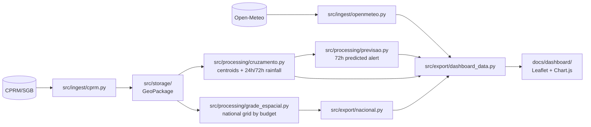
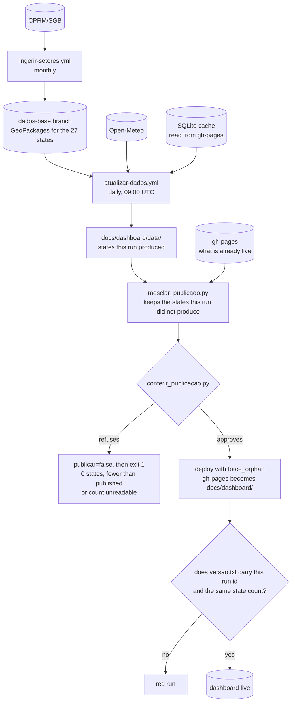

<div align="center">

<picture>
  <source media="(prefers-color-scheme: dark)" srcset="docs/logo/orca-logo-escuro.png">
  <source media="(prefers-color-scheme: light)" srcset="docs/logo/orca-logo-claro.png">
  
</picture>

# ORCA
*Open Risk and Catastrophe Aggregator*

**Brazil's official geological risk sectors (CPRM/SGB) cross-referenced with recent rainfall, in a static dashboard.**

[](CHANGELOG.md)
[](#installation)
[](https://hcristosm.github.io/ORCA/)
[](.github/workflows/ci.yml)
[](LICENSE)

*[Leia em português](README.md)*

</div>

---


## About

ORCA shows two sets of public data on the same map: the geological risk sectors
and the recent rainfall. It downloads the risk sectors from CPRM/SGB, the
Brazilian geological survey. Then it gets the rainfall for each sector. Then it
marks the sectors where the accumulated rainfall is above a threshold that you
select.

The idea comes from a real problem. I am a geologist and I have mapped risk
areas. I wanted to see the risk data and the rainfall data side by side, with no
backend, no server and no cost. Both sets of data are public, but they almost
never appear together.

ORCA has no backend. A Python pipeline makes static files. The dashboard in the
browser reads these files. Therefore the site runs on GitHub Pages at no cost.

**Live dashboard:** [hcristosm.github.io/ORCA/](https://hcristosm.github.io/ORCA/).
A cron job updates the data every day.

**Install it as an app:** open the dashboard in Chrome or in Edge. Click the
install icon in the address bar. On a telephone, use "Add to Home screen". ORCA
then has its own icon and window. It updates itself, and you remove it as you
remove any other program.

<p align="center">
  
  
</p>

## What the project does today

**Data and coverage**

- It covers the **27 states**. The dashboard has a state selector.
- It downloads the CPRM/SGB risk sectors incrementally. It keeps each state in a
  GeoPackage.
- It gets the hourly rainfall from **Open-Meteo**, at the center of each sector.
  It does not depend on a weather station.
- It calculates the accumulated rainfall for 24h and for 72h.
- It calculates a forecast alert track for the next 72h.
- It exports all the results as static GeoJSON and JSON.

**Map and interpretation**

- It serves a dashboard in plain HTML, CSS and JavaScript. The map uses Leaflet
  and the chart uses Chart.js. There is a light theme and a dark theme.
- It shows the risk level as a hatch pattern, in the style of a geological map.
  Color has one meaning only: the sector is above the threshold.
- It plots all the sectors of the state against the threshold, on a ruler. You
  drag the threshold and the ruler responds.
- It puts pins on the sectors above the threshold and on the sectors in forecast
  alert. Click a pin to go down to the municipality.
- It filters the map from the legend and from the counters, by risk level, by
  "above the threshold" and by "forecast alert".
- It uses three columns with independent scroll: context, map and panel. The map
  stays in view. Below a width of 1081px, the columns stack.

**Visitor tools**

- It exports reports in CSV and in PDF, inside the browser. You export the
  complete table, a single row or your own area.
- It accepts your own area on the "Minhas áreas" tab, as GeoJSON, KML or a
  shapefile in a `.zip`. The limit is 5 areas and 10MB per file. The calculation
  occurs in the browser. The file does not go to any server.
- It explains the ruler on the "Tutorial" tab. The tab also collects reference
  thresholds with their source: Defesa Civil de Santos, Concessionária Tamoios,
  PPDC-SP, the sirens of Rio, Petrópolis, Belo Horizonte and Tatizana et al. It
  also cites the literature for the 72h accumulation. Each criterion that fits
  the ruler has a "Usar Xmm/Yh" button. The button applies the window and the
  threshold, then returns to the map.
- It finds municipalities in all of Brazil, not only in the selected state. If
  you select a city in another state, the dashboard changes the state for you.
- It keeps the navigation in the URL (`#/<state>/<municipality>`). You use the
  Back and Forward buttons of the browser, you share the link and you click the
  breadcrumb.

**Live monitoring**

- It shows a freshness badge per source, in Brasília time: CPRM/SGB sectors and
  rainfall. The badge gives the age of the data. It warns you when a source is
  later than its expected cycle.
- It lists the official INMET weather warnings in the panel, in order of
  severity. The list has two filters: extent (this state, the IBGE macroregion
  of the current state, or all of Brazil) and day (today, tomorrow, and the next
  days with a warning). Therefore the list answers "will there be a storm in the
  Southeast on Sunday?". Click a warning to frame its polygon on the map. The
  map layer follows the same filter as the list.
- It turns three live layers on and off: INMET warnings (on by default, with the
  polygon in the severity color, plus risks and instructions), rainfall radar
  (RainViewer) and lightning (GOES-19 GLM, through SSEC RealEarth, as a storm
  indicator).

**Operation**

- It runs two separate workflows: the sectors once per month and the rainfall
  once per day.
- It has 161 tests with mocked HTTP. The CI runs the suite on every push.

## How to read the dashboard

The dashboard answers one question: **where does it rain a lot on a known risk
sector?** Three elements give that answer.

1. **The hatch pattern** gives the risk level of the sector, as CPRM/SGB
   classified it. It does not change with the rainfall.
2. **The color** shows a sector where the accumulated rainfall is above the
   threshold. Only this condition uses color.
3. **The ruler** shows all the sectors of the state against the threshold. Each
   mark is one sector. You drag the threshold and you see how many sectors are
   above it.

The accumulation window and the threshold are yours. The default is 100mm in
72h. This value is an example, and the "Tutorial" tab gives the thresholds of
real agencies.

The forecast alert uses the rainfall forecast for the next 72h. It shows the
sector that will go above the threshold, if the forecast is correct. It is not
an official alert.

> **Warning:** ORCA is not a replacement for the Civil Defense. It
> cross-references public, modeled data. In an emergency, follow the official
> agency of your city.

## Data sources

The pipeline uses two sources:

| Source | What it gives | Endpoint |
|---|---|---|
| [CPRM/SGB](https://www.sgb.gov.br/) | Risk sector polygons (level, type, homes and persons affected) | `geoportal.sgb.gov.br/.../risco/FeatureServer/0` (ArcGIS REST) |
| [Open-Meteo](https://open-meteo.com/) | Hourly rainfall per coordinate, with no station. The only rainfall source | `api.open-meteo.com/v1/forecast` |

CPRM is now SGB. Some of the old domains (`geoportal.cprm.gov.br` and related)
still answer. The risk layer is now at `geoportal.sgb.gov.br`.

The browser of the visitor gets five more sources live. These sources do not go
through the pipeline:

| Source | Map layer |
|---|---|
| [IBGE](https://servicodados.ibge.gov.br/) | Municipality boundaries (choropleth) |
| [INMET](https://portal.inmet.gov.br/) | Official weather warnings |
| [RainViewer](https://www.rainviewer.com/) | Rainfall radar |
| [SSEC RealEarth](https://realearth.ssec.wisc.edu/) | Lightning (GOES-19 GLM) |
| [OpenStreetMap](https://www.openstreetmap.org/) | Base map |

If one of these five sources fails, the layer disappears or the map degrades for
the visitor. The pipeline does not detect it. On the "Minhas áreas" tab, the
rainfall also comes from Open-Meteo directly to the browser.

## Architecture



Each module has one responsibility:

| Module | What it does |
|---|---|
| `src/cli.py` | Collects the command-line commands (Typer) |
| `src/config.py` | Holds **all** path conventions and the constants. Use `caminho_setores()`; do not build a path manually |
| `src/ingest/cprm.py` | Downloads the risk sectors per state, with pagination and a watermark |
| `src/ingest/openmeteo.py` | Gets the hourly rainfall per coordinate, in batches of 50 points |
| `src/ingest/rate_limiter.py` | Controls the request rate. It is shared |
| `src/storage/` | A thin layer over GeoPackage, for the sectors. There is no database |
| `src/storage_cache_openmeteo.py` | Keeps the downloaded rainfall in SQLite, to prevent a second request for the same hour. It stores only an hour that is in the past, to keep the forecast out of the accumulation as measured rainfall |
| `src/processing/cruzamento.py` | Gives the centroids (per sector and per municipality) and accumulates the rainfall in the window |
| `src/processing/grade_espacial.py` | Builds the adaptive national grid, by binary search |
| `src/processing/previsao.py` | Calculates the 72h alert track |
| `src/export/dashboard_data.py` | Exports one state |
| `src/export/nacional.py` | Orchestrates the 27 states with one shared grid |

The dashboard was a Streamlit app before. It became a static site for three
reasons: control of the layout and the aesthetics, publication as a page, and
independence from a running Python process.

## Repository layout

```
src/                      Python pipeline
tests/                    161 tests, with mocked HTTP
scripts/                  publication guard, merge and dashboard helper
docs/dashboard/           static front-end (published to gh-pages)
docs/dashboard/data/      pipeline output (ignored by git)
data/                     local GeoPackages (ignored by git)
.github/workflows/        CI, monthly ingestion, daily update, release
.github/actions/          preparar-python and baixar-branch
```

The front-end has no build step. It is four files: `index.html`, `comum.js`
(which loads first and exposes `window.ORCA`), `areas-customizadas.js` and
`relatorio.js`.

## Installation

ORCA requires Python 3.11 or later.

```bash
git clone https://github.com/hcristosm/ORCA
cd ORCA
python3 -m venv .venv
source .venv/bin/activate
pip install -e ".[dev]"
```

## Usage

### Download the risk sectors

This command uses CPRM/SGB. Run it once per month.

```bash
python -m src.cli ingerir-setores --diretorio data        # the 27 states
python -m src.cli ingest-cprm --uf SP                     # one state only
# -> data/risco_sp.gpkg
```

The ingestion is incremental. A watermark per state records what came before. In
the next run, ORCA requests only the changes.

### Export the dashboard data

```bash
python -m src.cli exportar-dashboard --uf SP
# -> docs/dashboard/data/setores_sp.geojson, series_sp.json, meta_sp.json, previsao_sp.json
```

This command needs the sectors in place. The rainfall comes from Open-Meteo at
that moment.

For all the states at the same time:

```bash
python -m src.cli atualizar-nacional --ufs SP,RJ,MG       # no --ufs = the 27
```

`atualizar-nacional` calculates one national spatial grid before it exports.
Therefore adjacent sectors share the same query point, also across state
borders. This keeps the number of points below `--orcamento-alvo` (the default
is 6,000; the Open-Meteo free limit is 10,000 per day). This command ingests
nothing. It expects the GeoPackages in `data/`.

### Open the dashboard

```bash
scripts/rodar_dashboard.sh    # a helper for python -m http.server 8000 --directory docs
```

Then open `http://localhost:8000/dashboard/`.

You must serve the dashboard over HTTP. The `fetch()` of the browser does not
read `file://`.

## Command-line reference

| Command | Purpose | Main options |
|---|---|---|
| `ingerir-setores` | Downloads the sectors of several states | `--ufs`, `--diretorio`, `--backoff-factor` |
| `ingest-cprm` | Downloads the sectors of one state | `--uf`, `--output`, `--timeout`, `--max-retries` |
| `exportar-dashboard` | Exports one state to the dashboard | `--uf`, `--diretorio`, `--saida` |
| `atualizar-nacional` | Exports several states with a shared grid | `--ufs`, `--orcamento-alvo`, `--diretorio`, `--saida` |

The workflows call two of these commands: `ingerir-setores` (monthly) and
`atualizar-nacional` (daily).

## Files the dashboard reads

The pipeline writes to `docs/dashboard/data/`. All the names are in lower case.

| File | Content |
|---|---|
| `setores_<uf>.geojson` | Sector polygons, with risk level, accumulated rainfall and alert |
| `series_<uf>.json` | Hourly rainfall series per municipality |
| `previsao_<uf>.json` | Alert track for the next 72h |
| `meta_<uf>.json` | Source, reference date, totals and data age |
| `ufs_disponiveis.json` | The list of published states |
| `versao.txt` | The id of the run that published. The smoke test reads it |

`ufs_disponiveis.json` controls the state selector of the front-end. It is also
the metric of the anti-regression guard.

## Environment variables

| Variable | Effect | Default |
|---|---|---|
| `ORCA_PISO_COBERTURA` | The coverage floor that publication accepts | `0.6` |
| `ORCA_LOG_LEVEL` | The log level of the pipeline | `INFO` |

## How it runs in production



A risk sector changes on a scale of months. The rainfall changes on a scale of
hours. Therefore there are two workflows:

- **Monthly** ([`ingerir-setores.yml`](.github/workflows/ingerir-setores.yml)):
  it downloads the sectors of the 27 states and publishes the GeoPackages to the
  `dados-base` branch. It is the only part of the project that uses SGB. The
  timeouts are generous (120s, 5 attempts) and there is no cache fallback. If
  SGB fails, the run fails loudly. It does not close green with empty data. The
  ingestion also distrusts HTTP 200: it retries the ArcGIS error that arrives
  with status 200, and it refuses the empty payload that would write a
  GeoPackage with 0 sectors.
- **Daily** ([`atualizar-dados.yml`](.github/workflows/atualizar-dados.yml),
  `0 9 * * *`): it reads the sectors from `dados-base`, runs
  `atualizar-nacional` and publishes to `gh-pages`. It uses no `.gov.br` source.

If SGB fails, the dashboard stays live with the sectors from `dados-base`.

One bad state does not stop the others. An unexpected error in one state — a
corrupt GeoPackage or a new SGB schema — stops that state only. The other states
continue, and the run fails at the end, to keep the failure visible.

The publication is non-destructive. Before it uploads, the job gets the current
`gh-pages`. It keeps the data of the states that this run did not produce
([`scripts/mesclar_publicado.py`](scripts/mesclar_publicado.py)). A state that
failed does not disappear from the dashboard: its data gets older.

Three guards protect this merge, and each refusal fails the run:

- The guard refuses if the run exported no state.
- The guard refuses if the new coverage is below the floor. The default is 60%,
  and the `ORCA_PISO_COBERTURA` variable changes the value. In a manual run with
  `--ufs`, the floor measures against the requested states (`--pedidas`), not
  against all 27. This 0.6 comes from
  the 12 clean runs between 2026-08-10 and 2026-08-23, with coverage between 70%
  and 100%. The floor is below the worst normal case, and it still stops the
  real degenerate cases of 4% and 7%.
- The guard refuses an empty set, an unreadable published count, or a regression
  in the total number of states against what is already live.

The logic is in [`scripts/conferir_publicacao.py`](scripts/conferir_publicacao.py).
Both workflows use this script. The guard always writes `publicar=false` to
`$GITHUB_OUTPUT` **before** it exits with 1, in that order. The output skips the
publication. The exit 1 makes the refusal visible: a silent guard in a daily
cron job could block the publication for weeks, and nobody would notice.

After the deploy, a smoke test waits for the public URL to serve the deploy of
that run. The marker is `versao.txt` with the id of the run, read past the CDN
cache. The test also compares the number of states that are live. A count alone
proves nothing, because yesterday's deploy also has 27 states. The marker is the
proof that the site comes from this run. If the Pages build fails, or if the
site serves something else, the run goes red.

These guards exist for a real reason. On 2026-08-22 and 2026-08-23, two runs
published 1 and 2 states out of 27 and closed as `success`, while the CPRM
ingestion failed with a timeout. **Never judge a run by its status. Measure the
result in the logs.**

## Branches

| Branch | Content |
|---|---|
| `main` | Code |
| `dados-base` | GeoPackages of the CPRM sectors (monthly ingestion) |
| `gh-pages` | The published dashboard and the Open-Meteo cache |

The deploy uses `force_orphan`. Therefore `gh-pages` becomes exactly the content
of `docs/dashboard/`. A publication with an empty `data/` would erase the 27
states and the cache with them. The guard exists against this.

## Tests and gates

```bash
.venv/bin/python -m pytest -q
.venv/bin/python -m ruff check .
.venv/bin/python -m mypy src
.venv/bin/python -m bandit -q -c pyproject.toml -r src
```

The CI runs these four commands on every push. Run them before you commit.

The 161 tests cover:

- the CPRM ingestion: ArcGIS REST, pagination, incremental watermark and retry;
- Open-Meteo: batches, retry and the SQLite cache;
- the processing: national spatial grid, rainfall accumulation and forecast;
- the publication: export, anti-regression guard and non-destructive merge with
  `gh-pages`.

Every network call is mocked, so the suite runs with no internet.

The dashboard itself (HTML and JavaScript) has no automated test. Its validation
is manual.

## Known limitations

- **The rainfall is modeled, not measured.** Open-Meteo gives reanalysis and
  forecast per coordinate, not a rain gauge reading. This makes the coverage of
  27 states possible, with no dependency on station density. It is not a direct
  observation.
- **There is no alternative rainfall source.** Open-Meteo is the only one. If it
  fails, the state stays out of the run and the dashboard data gets older
  instead of disappearing: the merge with `gh-pages` keeps the data of the day
  before.
- **The attention threshold is an example.** The default of 100mm/72h is a common
  reference in the landslide literature. It is not an official value, calibrated
  for the CPRM/SGB sectors. The dashboard says this, lets you change the value,
  and gives the thresholds of real agencies on the "Tutorial" tab.
- **The publication to `gh-pages` is not reversible yet.** The deploy uses
  `force_orphan: true`, so the branch has one commit only. This is necessary
  because of the Open-Meteo cache blob (~45MB), which changes every day. To stop
  the use of `force_orphan`, first move the cache out of the branch. Until then,
  the protection is preventive, not reversible.
- **Open-Meteo limits volume, not only frequency.** A test with a real request
  showed this: one POST with the ~900 coordinates of São Paulo works alone, but
  the same volume, repeated, gives a consistent `429`. `src/ingest/openmeteo.py`
  divides the points into batches of 50, uses a short history window and waits
  60s on a `429`.
- **The live layers depend on third parties.** The browser gets the INMET
  warnings, the radar and the lightning at that moment, with a timeout of 8s.
  If the source fails, or stops answering, the layer does not appear and the
  warning block says that the source is unavailable. The timeout is what makes
  these two cases equal: a host that hangs does not reject the `fetch`, and
  without the timeout the layer disappeared in silence. This condition is different from "no active warning",
  because a `.gov.br` site that is down answers 200 with the HTML of its portal.
  The rest of the panel does not depend on these sources. The lightning layer is
  also hidden when the most recent frame is more than 30 minutes old. It shows
  total lightning (cloud and ground), not the point of impact.
- **There is no authentication and no multi-user support.** ORCA is a local and
  portfolio tool.
- **The dashboard does not update on demand.** It shows the last export, which
  runs once per day. For newer data at that moment, run `exportar-dashboard`
  locally.

## Decisions and investigations

Real requests, not assumptions, decided the larger questions.

- **Streamlit to static site:** this solved the aesthetics, the layout and the
  distribution.
- **Open-Meteo as the only rainfall source:** it gives rainfall per coordinate,
  with no dependency on a station. INMET and ANA were implemented, then removed.
  INMET publishes only the annual ZIP file, with a delay of days. The ANA
  network is mostly for river gauges. The two paths cost ~1,900 lines that no
  workflow ran. The official INMET warnings returned as a list and a map layer
  only, read by the browser. They do not enter the calculation.
- **National coverage:** incremental CPRM ingestion, plus a spatial grid
  calibrated by binary search. The alternative was a density threshold, selected
  by hand.
- **Code graph removed:** the evaluation of 2026-09-12 measured a `graph.json`
  of 825 KB against 121 KB for all of `src/`. The map cost more than the
  territory. An explicit README and CLAUDE.md are a better answer.

## Roadmap

- Move the Open-Meteo cache out of `gh-pages`, to stop the use of `force_orphan`
  and recover the history of the published branch.
- A municipal fallback, with city ArcGIS REST layers. The investigation of
  2026-08-14 for Itaquaquecetuba/SP confirmed no public endpoint. This item
  waits for a pilot city with open data.
- Better orchestration of the Open-Meteo requests: pagination, a more complete
  backoff and possibly a queue to space the requests.

## How this was built

I am a geologist, not a trained developer. ORCA is in large part the result of
vibe coding with Claude Code. I bring the problem, the domain knowledge and the
decisions. Claude writes most of the code. I review it, test it and correct the
direction when the result does not match the reality of the data.

I prefer to make this clear. If you find something strange in the code, this is
probably the reason. An issue is welcome.

## About the language of this text

This README follows, in large part, the ASD-STE100 standard (Simplified
Technical English): short sentences, the active voice, the present tense, one
idea per sentence, and the same term for the same thing. "Sector", "threshold",
"run" and "state" have one meaning each in all of the text.

The standard is not applied to the letter. The "About" and "How this was built"
sections keep a personal voice. The objective is a text that is easy to read,
also for a reader whose first language is not English and for an AI agent, and
that does not sound robotic. If you edit this file, keep the same style.

## Contributing

Issues, PRs and suggestions are welcome. See the
[contribution guide](CONTRIBUTING.md) and the
[Code of Conduct](CODE_OF_CONDUCT.md).

## License

[GNU AGPL v3.0 or later](LICENSE): free use, copying, modification and
redistribution, including commercial use, on the condition that any distributed
version **or version offered as a service over a network** publishes the
complete source code under the same license, and keeps the copyright notice of
Mateus Hcristos Leptokarydis. Versions up to v2.1.0 were published under BSD
3-Clause.

The public data belongs to its agencies:
[CPRM/SGB](https://www.sgb.gov.br/) and [Open-Meteo](https://open-meteo.com/).
The live map layers come from INMET, IBGE, RainViewer, SSEC RealEarth and
OpenStreetMap. Read the terms of use of each one before you redistribute.
