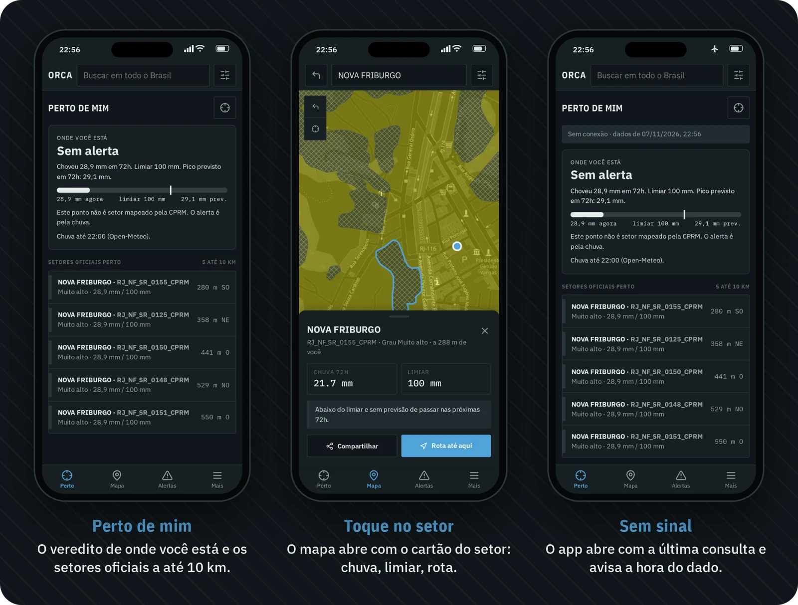

<div align="center">


# ORCA
*Open Risk and Catastrophe Aggregator*

**Brazil's official geological risk sectors (CPRM/SGB) cross-referenced with recent rainfall, in a static dashboard.**

[](CHANGELOG.md)
[](#installation)
[](https://hcristosm.github.io/ORCA/)
[](.github/workflows/ci.yml)
[](LICENSE)

*[Leia em português](README.md)*

</div>

---

## About

ORCA shows two sets of public data on the same map: the geological risk sectors
and the recent rainfall. It downloads the risk sectors from CPRM/SGB, the
Brazilian geological survey. It gets the rainfall for each sector. Then it marks
the sectors where the accumulated rainfall is above a threshold that you select.

The idea comes from a real problem. I am a geologist and I have mapped risk
areas. Both sets of data are public, but they almost never appear together. I
wanted to see them side by side with no server and no cost. A Python pipeline
makes static files, and the dashboard in the browser reads these files. The site
runs on GitHub Pages, and a cron job updates the data every day.

**Live dashboard:** [hcristosm.github.io/ORCA/](https://hcristosm.github.io/ORCA/)

<p align="center">
  
  
</p>

> **Caution:** ORCA does not replace the Civil Defense. It cross-references
> public and modelled data. In an emergency, obey the official agency of your
> city or call 199.

## How to read the dashboard

The dashboard answers one question: **where does much rain fall on a known risk
sector?** Three elements give the answer.

1. **The hatching** shows the risk level of the sector, as CPRM/SGB defines it.
   It does not change with the rainfall.
2. **The color** shows a sector with accumulated rainfall above the threshold.
   Only this state uses color.
3. **The ruler** shows all the sectors of the state against the threshold. Each
   mark is a sector. Drag the threshold to see how many sectors go above it.

You select the accumulation window (24h or 72h) and the threshold. The default
is 100mm in 72h, which is an example value. The "Critério" selector and the
"Tutorial" tab show the thresholds of real agencies, with their sources: Santos
Civil Defense, Concessionária Tamoios, PPDC-SP, the Rio de Janeiro sirens, Belo
Horizonte and others.

The **forecast alert** uses the rainfall forecast for the next 72h. It shows the
sector that will go above the threshold if the forecast is correct. It is not an
official alert.

## On a telephone

<p align="center">
  
</p>

On a telephone, ORCA opens on the **Perto de mim** (Near me) tab. It asks for
your location. Then it tells you if the place where you are can go into alert.

- It gives the verdict for your point: imminent risk, forecast alert (with the
  time), no alert or no data. Outside a mapped sector, only the rainfall gives
  the alert, and the screen tells you that this does not mean that there is no
  risk.
- It lists the CPRM/SGB sectors in a radius of 10 km, with distance and
  direction.
- One tap opens the sector on the map. The card shows the rainfall, the
  threshold and the buttons to share and to get a route.
- It opens with no signal, with your last result and the time of the data.

The telephone does all the calculation. It downloads a small index of the
sectors of all of Brazil (`setores_pontos.json`, approximately 530 KB with
gzip). It gets the rainfall for your point directly from Open-Meteo.

### Install it as an app

You install ORCA from the browser. You do not need an app store. ORCA then has
its own icon and window. It updates itself, and you remove it as you remove any
other app.

**Android (Chrome):** open [hcristosm.github.io/ORCA](https://hcristosm.github.io/ORCA/),
tap the ⋮ menu and select **Install app** (in some versions, **Add to Home
screen**).

<p align="center">
  
</p>

**iPhone (Safari):** open the same address. Tap **Share**, then tap **Add to
Home Screen**. In iOS 26, Share is in the ⋯ menu of the Safari bar.

<p align="center">
  
</p>

**Computer (Chrome or Edge):** click the install icon in the address bar.

The bars and menus in the figures are diagrams. The figures show the Portuguese
labels, and the names of the options change a little between versions.

## What else the dashboard does

- **It covers the 27 states.** The municipality search works for all of Brazil
  and changes the state automatically. A municipality with no CPRM sector also
  shows, with the label "sem setor CPRM" (no CPRM sector). See
  [Known limitations](#known-limitations).
- **It filters** the map from the legend and the counters: by risk level, by
  "above the threshold" and by "forecast alert". Pins mark the sectors that need
  attention.
- **It exports reports** in CSV and PDF, in the browser: the full table, one row
  or your own area.
- **It accepts your own areas** in the "Minhas áreas" (My areas) tab, as
  GeoJSON, KML or a zipped shapefile (maximum 5 areas, 10MB each). The file
  stays in your browser.
- **It keeps the navigation in the URL**
  (`#/<state>/<municipality>?l=<threshold>&j=<window>`). A shared link opens
  with the same ruler as the sender's, and Back/Forward work. With no link, the
  dashboard opens where you stopped.
- **It shows live data:** the official weather warnings from INMET (a list and
  polygons on the map, by state, region or Brazil, and by day), rain radar and
  lightning.
- **It tells you the age of each set of data.** The update badge warns you when
  a source is late.
- **It stays current on a monitoring screen:** a tab that is open for more than
  30 minutes and idle for 5 minutes reloads itself.

## Data sources

The pipeline uses two sources:

| Source | What it supplies |
|---|---|
| [CPRM/SGB](https://www.sgb.gov.br/) | Risk sector polygons: risk level, type, homes and people affected. ArcGIS REST at `geoportal.sgb.gov.br` |
| [Open-Meteo](https://open-meteo.com/) | Hourly rainfall and forecast by coordinate. It is the only rainfall source: it does not depend on a weather station |

The browser of the person who looks at the dashboard gets other live sources,
outside the pipeline. If one of them fails, only that layer is missing, and the
layer control tells you why.

| Source | Use in the dashboard |
|---|---|
| [IBGE](https://servicodados.ibge.gov.br/) | Municipality boundaries (choropleth) |
| [INMET](https://portal.inmet.gov.br/) | Official weather warnings |
| [RainViewer](https://www.rainviewer.com/) | Rain radar |
| [SSEC RealEarth](https://realearth.ssec.wisc.edu/) | Lightning (GOES-19 GLM) |
| [OpenStreetMap](https://www.openstreetmap.org/) | Base map |

The list of municipalities for the search (`docs/dashboard/municipios.json`)
comes from IBGE, but it is static and kept in the repository: the search does
not need IBGE to be online.

## Architecture

| Module | What it does |
|---|---|
| `src/cli.py` | Command-line commands (Typer) |
| `src/config.py` | **All** path conventions and constants. Use `caminho_setores()`, do not build a path by hand |
| `src/ingest/cprm.py` | Risk sectors by state, with pagination and incremental ingestion |
| `src/ingest/openmeteo.py` | Hourly rainfall by coordinate, in batches of 50 points |
| `src/ingest/rate_limiter.py` | Request pacing, shared |
| `src/storage/` | Thin layer on GeoPackage. There is no database |
| `src/storage_cache_openmeteo.py` | SQLite cache of the rainfall already downloaded. It keeps only past hours, so that the forecast does not become observed rainfall |
| `src/processing/cruzamento.py` | Centroids (by sector and by municipality) and rainfall accumulated in the window |
| `src/processing/grade_espacial.py` | Adaptive national grid, which groups near sectors on one query point |
| `src/processing/previsao.py` | 72h alert trajectory |
| `src/export/dashboard_data.py` | Exports one state |
| `src/export/nacional.py` | Runs the 27 states with one shared grid |

## Repository layout

```
src/                      Python pipeline
tests/                    Python tests (mocked HTTP) and JS tests
scripts/                  publication guard, merge, generators and dashboard shortcut
docs/dashboard/           static front end (published to gh-pages)
docs/dashboard/data/      pipeline output (ignored by git)
data/                     local GeoPackages (ignored by git)
.github/workflows/        CI, monthly ingestion, daily update, release
.github/actions/          preparar-python and baixar-branch
```

The front end is plain JavaScript, with no build step. `index.html` loads
`comum.js` first (it exposes `window.ORCA`). The calculations with no DOM are in
`calculo.js`; the telephone version is in `movel.js` and `perto.js`; "Minhas
áreas" and the reports are in `areas-customizadas.js` and `relatorio.js`; the
offline mode is in `sw.js`.

## Installation

ORCA requires Python 3.11 or later.

```bash
git clone https://github.com/hcristosm/ORCA
cd ORCA
python3 -m venv .venv
source .venv/bin/activate
pip install -e ".[dev]"
```

## Usage

### Download the risk sectors

This command connects to CPRM/SGB. The ingestion is incremental: the second
time, it asks only for what changed.

```bash
python -m src.cli ingerir-setores --diretorio data        # all 27 states
python -m src.cli ingest-cprm --uf SP                     # one state
# -> data/risco_sp.gpkg
```

### Export the dashboard data

These commands need the sectors that you ingested before. The rainfall comes
from Open-Meteo at that time.

```bash
python -m src.cli exportar-dashboard --uf SP              # one state
python -m src.cli atualizar-nacional --ufs SP,RJ,MG       # several; with no --ufs, all 27
```

`atualizar-nacional` makes one spatial grid for all of Brazil before the
export. Near sectors, also in neighbouring states, use the same query point, and
the total stays in `--orcamento-alvo` (default 6,000; the Open-Meteo free limit
is 10,000 per day).

### Open the dashboard

```bash
scripts/rodar_dashboard.sh    # serves docs/ at http://localhost:8000/dashboard/
```

The dashboard needs HTTP: the browser `fetch()` does not read `file://`.

## Reference

### Command line

| Command | What it does | Main options |
|---|---|---|
| `ingerir-setores` | Downloads the sectors of several states (monthly workflow) | `--ufs`, `--diretorio`, `--backoff-factor` |
| `ingest-cprm` | Downloads the sectors of one state | `--uf`, `--output`, `--timeout`, `--max-retries` |
| `atualizar-nacional` | Exports several states with a shared grid (daily workflow) | `--ufs`, `--orcamento-alvo`, `--diretorio`, `--saida` |
| `exportar-dashboard` | Exports one state | `--uf`, `--diretorio`, `--saida` |
| `indexar-setores` | Makes the small index for the Near me screen | |

### Files the dashboard reads

The pipeline writes to `docs/dashboard/data/`, with lowercase names.

| File | Content |
|---|---|
| `setores_<uf>.geojson` | Sector polygons, with risk level, accumulated rainfall and alert |
| `series_<uf>.json` | Hourly rainfall series by municipality |
| `previsao_<uf>.json` | Alert trajectory for the next 72h |
| `meta_<uf>.json` | Source, reference date, totals and age of the data |
| `setores_pontos.json` | Small national index of the sectors, for the telephone |
| `ufs_disponiveis.json` | Published states. It controls the state selector and the publication guard |
| `versao.txt` | Id of the run that published, for the smoke test |

### Environment variables

| Variable | Effect | Default |
|---|---|---|
| `ORCA_PISO_COBERTURA` | Minimum fraction of states that a publication must have | `0.6` |
| `ORCA_LOG_LEVEL` | Pipeline log level | `INFO` |

## How it runs in production

A risk sector changes in months; the rainfall changes in hours. Thus there are
two workflows:

- **Monthly** ([`ingerir-setores.yml`](.github/workflows/ingerir-setores.yml)):
  downloads the sectors of the 27 states and publishes the GeoPackages to the
  `dados-base` branch. It is the only part that connects to SGB. If SGB fails,
  or sends an empty response with HTTP 200, the state keeps the data of the
  previous month and the run fails visibly.
- **Daily** ([`atualizar-dados.yml`](.github/workflows/atualizar-dados.yml)):
  reads the sectors from `dados-base`, gets the rainfall and publishes to
  `gh-pages`. It does not connect to a `.gov.br` source.

The publication does not delete good data:

- **One bad state does not stop the others.** A state that fails keeps the data
  of the previous day: it gets older, but it does not disappear.
- **The guard refuses to publish less than what is live**, to publish below the
  coverage floor, or to publish when it cannot read what is live. Each refusal
  makes the run red.
- **The smoke test** makes sure that the public site serves the deploy of this
  run, not the deploy of the previous day.

These rules come from two runs in 2026 that deleted the dashboard and closed as
`success`. Thus the rule of the project: **never judge a run by its status.**

| Branch | Content |
|---|---|
| `main` | Code |
| `dados-base` | GeoPackages of the CPRM sectors (monthly ingestion) |
| `gh-pages` | Published dashboard and Open-Meteo cache |

## Tests and gates

```bash
.venv/bin/python -m pytest -q
.venv/bin/python -m ruff check .
.venv/bin/python -m mypy src
.venv/bin/python -m bandit -q -c pyproject.toml -r src
```

The CI runs these four commands on each push. Run them before you commit. All
network calls are mocked, so the suite runs with no internet.

The front-end calculations (distance, near sectors, trajectory, verdict and CPRM
coverage by municipality) have tests in `tests/js/calculo.html`. They run in the
browser, because the project does not use Node: serve the repository root with
`python3 -m http.server 8001` and open
`http://localhost:8001/tests/js/calculo.html`. The page ends with "PASSOU n/n".
You check the rest of the dashboard manually.

## Known limitations

- **CPRM did not map all cities.** The sector data covers approximately 1,600
  municipalities. São Paulo, Rio de Janeiro, Belo Horizonte, Recife, Salvador
  and cities with recent disasters, such as Petrópolis, São Sebastião and
  Guarujá, are not in it. There, a state or city agency makes the mapping (IPT,
  DRM-RJ, city governments). ORCA shows these municipalities in the search as
  "sem setor CPRM" and gives the alert from the rainfall only. **No sector does
  not mean no risk.**
- **The rainfall is modelled, not measured.** Open-Meteo supplies reanalysis and
  forecast by coordinate, not rain gauge readings. This covers the 27 states
  with no weather stations, but it is not a direct observation.
- **There is no alternative rainfall source.** If Open-Meteo fails, the state is
  not in the run and the dashboard shows the data of the previous day.
- **The default threshold is an example.** 100mm/72h is a common value in the
  literature, not an official value calibrated for the CPRM/SGB sectors.
- **The dashboard does not update on demand.** It shows the export of the day.
  The "Atualizar agora" (Update now) button of a municipality gets the rainfall
  of one point at that time, but it does not calculate the state again.
- **The live layers depend on third parties.** INMET, radar and lightning come
  directly to the browser, with a timeout of 8s. The lightning layer shows total
  lightning (cloud and ground), not the point of impact.
- **`gh-pages` has no history.** The deploy uses `force_orphan`, because of the
  Open-Meteo cache (~45MB) that changes every day. The protection against a bad
  publication prevents it; it cannot reverse it.

## Roadmap

- Cover the municipalities with no CPRM sectors with state and city sources.
- Move the Open-Meteo cache out of `gh-pages`, to stop the use of
  `force_orphan` and get back the history of the published branch.

## How this was built

I am a geologist, not a trained developer. I built most of ORCA by vibe coding
with Claude Code. I bring the problem, the domain knowledge and the decisions.
Claude writes most of the code. I review it, I test it, and I correct the
direction when the result does not agree with the real data.

I think it is better to say this clearly than to pretend otherwise. If you find
something strange in the code, this is probably why. An issue is welcome.

## Contributing

Issues, PRs and suggestions are welcome. See the
[contributing guide](CONTRIBUTING.md) and the
[Code of Conduct](CODE_OF_CONDUCT.md).

## License

[GNU AGPL v3.0 or later](LICENSE): free use, copying, modification and
redistribution, including commercial use, on the condition that any distributed
version **or version offered as a service over a network** publishes the
complete source code under the same license, and keeps the copyright notice of
Mateus Hcristos Leptokarydis. Versions up to v2.1.0 were published under BSD
3-Clause.

The public data belongs to its agencies:
[CPRM/SGB](https://www.sgb.gov.br/) and [Open-Meteo](https://open-meteo.com/).
The live map layers come from INMET, IBGE, RainViewer, SSEC RealEarth and
OpenStreetMap. Read the terms of use of each one before you redistribute.
