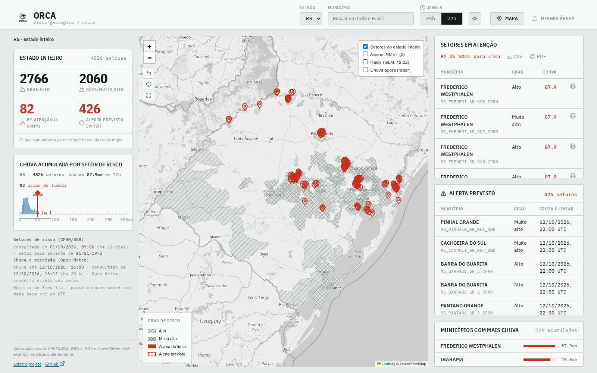
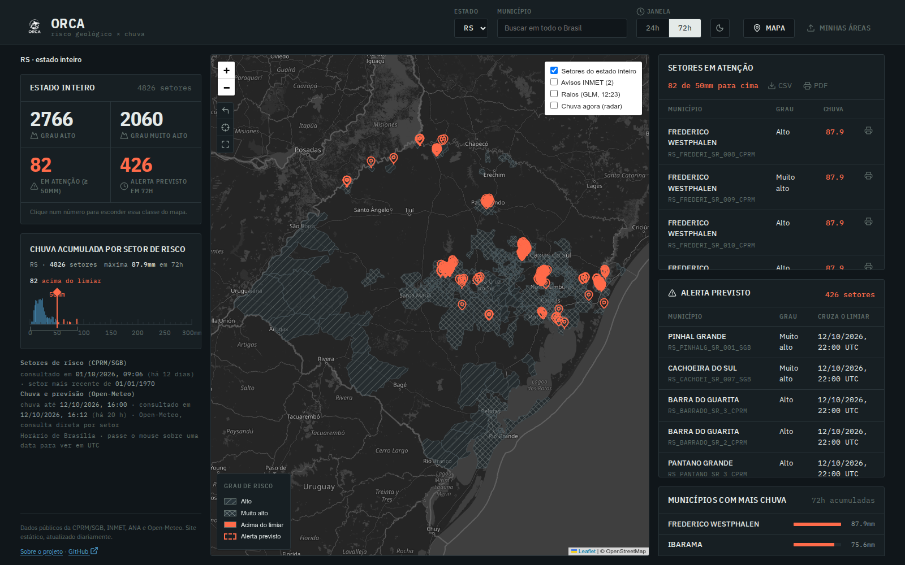

<div align="center">


*Open Risk and Catastrophe Aggregator*

**Brazil's geological risk sectors cross-referenced with recent rainfall, in a static dashboard.**

[](CHANGELOG.md)
[](#run-it-locally)
[](https://hcristosm.github.io/ORCA/)
[](.github/workflows/ci.yml)
[](LICENSE)

*[Leia em português](README.md)*

</div>

---

## About

ORCA shows two sets of public data on the same map: the geological risk sectors
and the recent rainfall. It reads the risk sectors from
[BELUGA](https://github.com/hcristosm/BELUGA), gets the rainfall for each
sector, and marks the ones that crossed an accumulated rainfall threshold you
choose.

The idea came from a concrete problem. I am a geologist and I have mapped risk
areas myself. Both datasets are public, yet they almost never appear together. I
wanted to see them side by side with no server and no cost: a Python pipeline
writes static files, and the dashboard in the browser reads them. The site runs
on GitHub Pages, and a cron job updates the data every day.

**Live dashboard:** [hcristosm.github.io/ORCA/](https://hcristosm.github.io/ORCA/)

<p align="center">
  
  
</p>

> **Warning:** ORCA does not replace Civil Defence. It cross-references public
> and modelled data. In an emergency, follow your city's official agency or call
> 199.

## Who it is for

- **Civil defence and municipal staff.** Open the link, pick a state and see on
  one map which mapped sectors got more rain than the threshold your agency
  uses. Nothing to install and no account to create, and the selection exports
  to CSV or PDF for the daily report.
- **Research and teaching.** Compare rainfall thresholds from different
  agencies over the same set of sectors, or use the exported data in class and
  in academic work.
- **Developers.** The code is open and the data is static files. You can reuse
  the ingestion, swap the rainfall source or point the dashboard at another
  sector dataset.

## How to read the dashboard

The dashboard answers one question: **where is it raining heavily over a known
risk sector?** Three elements give that answer.

1. **The hatching** shows the risk grade of the sector, as the agency that
   mapped it recorded. It does not change with the rain.
2. **The colour** marks a sector with accumulated rainfall above the threshold.
   Only that state uses colour.
3. **The ruler** plots every sector in the state against the threshold. Each
   tick is one sector. Drag the threshold and see how many cross it.

The accumulation window (24h or 72h) and the threshold are yours. The default is
100mm over 72h, an illustrative value. The "Critério" selector and the "Tutorial"
tab carry thresholds used by real agencies, with sources: Santos Civil Defence,
the Tamoios highway operator, PPDC-SP, Rio's sirens, Belo Horizonte and others.

The **forecast alert** uses the rainfall forecast for the next 72h. It flags the
sector that should cross the threshold if the forecast holds. It is not an
official alert.

### Not every sector is alike

The sectors come from different surveys, and that shows on screen.

- **Risk grade.** Most are R1 to R4 (Low to Very high). The Belo Horizonte
  areas, mapped in 1996, carry **no grade**: they get their own hatching and
  legend entry, and they count and cross-reference with rainfall like the rest.
- **Points instead of polygons.** Recife and Contagem mapped buildings and
  points, not polygons. They get their own marker, and "you are inside the
  sector" becomes proximity within 50 metres.
- **Overlap.** A municipal sector may cover the same slope as a CPRM sector. The
  sector card says so, the legend filters by that relation, and a sector that
  repeats more than half the area of a CPRM sector is left out of the header
  count, with a line saying how many were. No sector is hidden; none is counted
  twice in silence.

## On a telephone

<p align="center">
  
</p>

On a telephone, ORCA opens on the **Perto de mim** (Near me) tab. It asks for
your location and tells you whether the place you are in could go into alert.

- It gives a verdict for the point: imminent risk, forecast alert (with the
  time), no alert, or no data. Outside a mapped sector, the alert comes from
  rainfall alone, and the screen says that this does not mean there is no risk.
- It lists official sectors within 10 km, with distance, bearing and who mapped
  them.
- It opens the sector on the map with one tap. The card shows the rainfall, the
  threshold and the share and route buttons.
- It opens offline, with the last query and the timestamp of the data.

The maths runs on the device: the phone downloads a light index of every sector
in Brazil (`setores_pontos.json`) and queries the rainfall for the point
straight from Open-Meteo.

### Install it as an app

ORCA installs from the browser, with no app store. It gets its own icon and
window, updates itself and uninstalls like any app.

**Android (Chrome):** open [hcristosm.github.io/ORCA](https://hcristosm.github.io/ORCA/),
tap the ⋮ menu and choose **Install app** (in some versions, **Add to Home
screen**).

<p align="center">
  
</p>

**iPhone (Safari):** open the same address, tap **Share** and then **Add to Home
Screen**. On iOS 26, Share lives inside the ⋯ menu in the Safari bar.

<p align="center">
  
</p>

**Desktop (Chrome or Edge):** click the install icon in the address bar.

The bars and menus in the figures are schematic. Option names change a little
between versions.

## What else the dashboard does

- **Covers all 27 states.** Municipality search works across Brazil and switches
  the state on its own. A municipality with no mapped sector also shows up,
  marked as such (see [Known limitations](#known-limitations)).
- **Filters** the map from the legend and the counters: by grade, by mapping
  source, by overlap with CPRM, by "above threshold" and by "forecast alert".
  Pins mark the sectors that need attention.
- **Exports reports** as CSV and PDF, inside the browser: the whole table, a
  single row, or a custom area. The report credits every source with its
  licence.
- **Takes your own areas** on the "Minhas áreas" tab, as GeoJSON, KML or a
  shapefile `.zip` (up to 5 areas, 10MB each). The file never leaves the
  browser.
- **Keeps navigation in the URL** (`#/<state>/<municipality>?l=<threshold>&j=<window>`).
  A shared link opens with the same ruler the sender had, and Back/Forward work.
  With no link, the dashboard reopens where you left it.
- **Shows live data:** INMET weather warnings (list and polygons on the map, by
  state, region or the whole country, and by day), rainfall radar and lightning.
- **Tells you how old each dataset is.** The freshness seal names the sources
  for that state and warns when one of them is past its expected cycle.
- **Stays current on a monitoring screen:** a tab open for more than 30 minutes
  and idle for 5 reloads itself.

## Sources and credits

Every risk sector comes from [BELUGA](https://github.com/hcristosm/BELUGA), a
sibling project that catalogues, collects and standardises risk mapping in
Brazil. That is **21,429 sectors across 27 states**, from seven sources:

| Source | Agency | Where | Sectors |
|---|---|---|---:|
| Geological Risk Sectorisation | SGB/CPRM | 27 states | 18,890 |
| Geological risk sectors of Juiz de Fora | SSPDC, Juiz de Fora City Hall | MG | 994 |
| Geological Risk Areas of Belo Horizonte | PBH (1996 UFMG study) | MG | 665 |
| Risk Areas of the South Region of Recife | Sedec, Recife City Hall | PE | 364 |
| Geological and hydrological risk of Contagem (2024) | Contagem City Hall | MG | 265 |
| Risk sectors of Suzano (2019) | Suzano City Hall | SP | 178 |
| Geological risk from the Congonhas PMRR | Congonhas City Hall | MG | 73 |

The field survey belongs to each agency. **Every sector carries its source's
licence**, in the dashboard, in the reports and in the credits. The Recife data
is ODbL, which requires sharing the derivative under the same licence.

Rainfall comes from [Open-Meteo](https://open-meteo.com/), hourly and by
coordinate. It is the pipeline's only rainfall source: it does not depend on
weather stations.

The reader's browser fetches other sources live, outside the pipeline. If one of
them goes down, only that layer is missing, and the layer control says why.

| Source | Use in the dashboard |
|---|---|
| [IBGE](https://servicodados.ibge.gov.br/) | Municipality boundaries and the search list |
| [INMET](https://portal.inmet.gov.br/) | Official weather warnings |
| [RainViewer](https://www.rainviewer.com/) | Rainfall radar |
| [SSEC RealEarth](https://realearth.ssec.wisc.edu/) | Lightning (GOES-19 GLM) |
| [OpenStreetMap](https://www.openstreetmap.org/) | Base map |

## Run it locally

Requires Python 3.11 or newer.

```bash
git clone https://github.com/hcristosm/ORCA
cd ORCA
python3 -m venv .venv
.venv/bin/pip install -e ".[dev]"

.venv/bin/python -m src.cli baixar-beluga --ufs SP,RJ,MG
.venv/bin/python -m src.cli atualizar-nacional --ufs SP,RJ,MG
scripts/rodar_dashboard.sh    # http://localhost:8000/dashboard/
```

The dashboard needs HTTP: the browser's `fetch()` will not read `file://`.

The commands, the workflows, the publication guards and how to roll back are in
**[docs/funcionamento.md](docs/funcionamento.md)** (in Portuguese).

## Known limitations

- **Coverage is still partial.** CPRM sectorisation covers about 1,600
  municipalities, and the municipal sources cover six cities. São Paulo, Rio de
  Janeiro and Salvador are missing, as are cities with recent disasters such as
  Petrópolis, São Sebastião and Guarujá. ORCA shows those municipalities in
  search as having no mapped sector and raises the alert from rainfall alone.
  **No sector does not mean no risk.**
- **The surveys are not comparable with each other.** Different dates, methods
  and scales, from 1996 to 2024. Two sectors with the same grade from different
  sources do not mean the same risk.
- **Rainfall is modelled, not measured.** Open-Meteo provides reanalysis and
  forecast by coordinate, not rain gauge readings. That covers all 27 states
  without depending on stations, but it is not direct observation.
- **There is no alternative rainfall source.** If Open-Meteo goes down, the
  state is left out of the run and the dashboard shows yesterday's data.
- **The default threshold is illustrative.** 100mm/72h is a common reference in
  the literature, not an official value calibrated for these risk sectors.
- **The dashboard does not update on demand.** It shows the day's export. A
  municipality's "Atualizar agora" button fetches the rainfall for one point on
  the spot, but does not recompute the state.
- **Live layers depend on third parties.** INMET, radar and lightning come
  straight from the browser, with an 8s timeout. The lightning layer shows total
  lightning (cloud and ground), not strike points.
- **Licences are not always declared.** CPRM, Juiz de Fora, Contagem, Suzano and
  Congonhas declare no licence in their source services. That is recorded, not
  resolved.

## How this was built

I am a geologist, not a trained developer. ORCA was built largely by vibe coding
with Claude Code. I bring the problem, the domain knowledge and the decisions.
Claude writes most of the code. I review, test and correct course when the
result does not match the reality of the data.

I would rather make that clear than pretend otherwise. If you find something odd
in the code, that is probably why. An issue is welcome.

## Contributing

Issues, PRs and suggestions are welcome. See the
[contributing guide](CONTRIBUTING.md) and the
[Code of Conduct](CODE_OF_CONDUCT.md).

## How to cite

If ORCA ends up in a paper, report or thesis, use the **Cite this repository**
button at the top of the GitHub page. It reads [`CITATION.cff`](CITATION.cff)
and gives the reference in APA and BibTeX. Please also cite
[BELUGA](https://github.com/hcristosm/BELUGA) and the primary source of the
sectors: the field survey belongs to CPRM/SGB or to the agency that mapped them.

## License

[GNU AGPL v3.0 or later](LICENSE): free to use, copy, modify and redistribute,
including commercially, as long as any version distributed **or offered as a
service over a network** publishes the complete source code under the same
license, keeping the copyright notice of Mateus Hcristos Leptokarydis. Versions
up to v2.1.0 were released under BSD 3-Clause.

**The published data follows each source's licence**, stated in the dashboard,
in the reports and in BELUGA's `manifest.json`. The live map layers come from
INMET, IBGE, RainViewer, SSEC RealEarth and OpenStreetMap. Check each one's
terms of use before redistributing.
