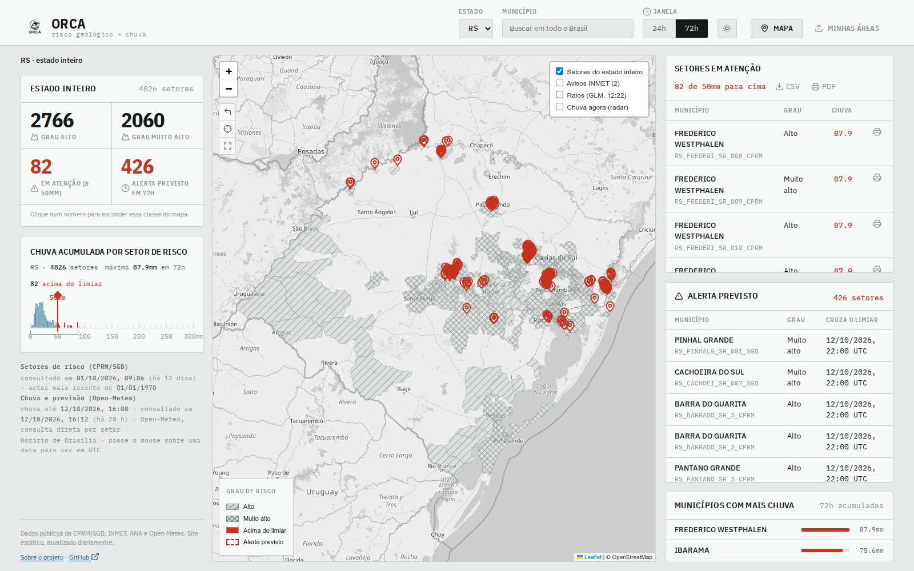
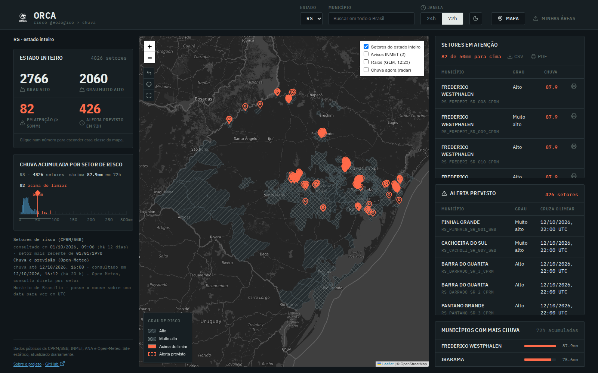
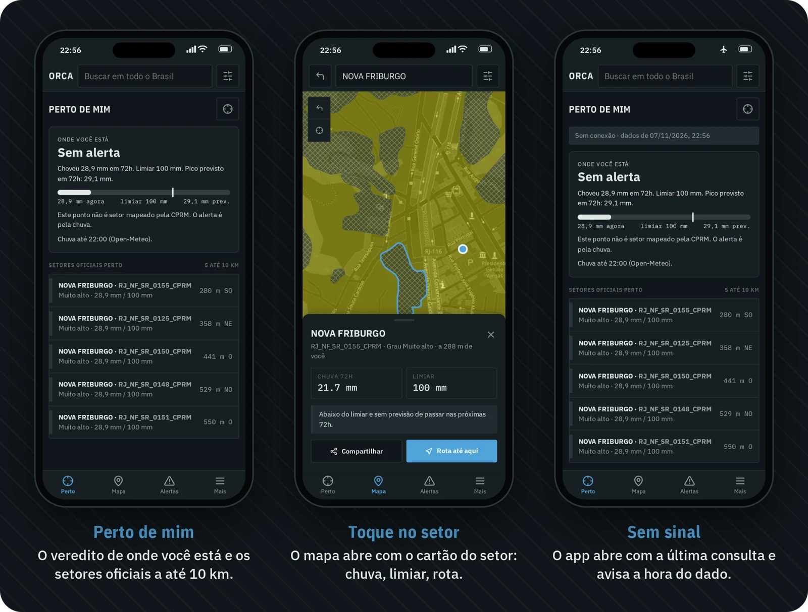

<div align="center">


# ORCA
*Open Risk and Catastrophe Aggregator*

**Setores de risco geológico da CPRM/SGB cruzados com chuva recente, num dashboard estático.**

[](CHANGELOG.md)
[](#instalação)
[](https://hcristosm.github.io/ORCA/)
[](.github/workflows/ci.yml)
[](LICENSE)

*[Read in English](README.en.md)*

</div>

---

## Sobre

O ORCA mostra duas informações públicas no mesmo mapa: o setor de risco
geológico e a chuva recente. Ele baixa a setorização de risco da CPRM/SGB,
busca a chuva de cada setor e marca os setores com chuva acumulada acima de um
limiar que você escolhe.

A ideia veio de um problema concreto. Sou geólogo e já mapeei área de risco. As
duas informações são públicas, mas quase nunca aparecem juntas. Eu queria vê-las
lado a lado sem servidor e sem custo: um pipeline em Python gera arquivos
estáticos, e o dashboard no navegador lê esses arquivos. O site roda no GitHub
Pages, e um cron atualiza os dados todo dia.

**Dashboard ao vivo:** [hcristosm.github.io/ORCA/](https://hcristosm.github.io/ORCA/)

<p align="center">
  
  
</p>

> **Atenção:** o ORCA não substitui a Defesa Civil. Ele cruza dado público e
> modelado. Em uma emergência, siga o órgão oficial da sua cidade ou ligue 199.

## Como ler o dashboard

O dashboard responde uma pergunta: **onde chove muito sobre um setor de risco
conhecido?** Três elementos dão essa resposta.

1. **A hachura** mostra o grau de risco do setor, de acordo com a CPRM/SGB. Ela
   não muda com a chuva.
2. **A cor** mostra um setor com chuva acumulada acima do limiar. Só esse estado
   usa cor.
3. **A régua** mostra todos os setores da UF contra o limiar. Cada marca é um
   setor. Você arrasta o limiar e vê quantos setores passam dele.

A janela de acumulação (24h ou 72h) e o limiar são seus. O padrão é 100mm em
72h, um valor ilustrativo. O seletor "Critério" e a aba "Tutorial" trazem os
limiares de órgãos reais, com fonte: Defesa Civil de Santos, Concessionária
Tamoios, PPDC-SP, sirenes do Rio, Belo Horizonte e outros.

O **alerta previsto** usa a previsão de chuva das próximas 72h. Ele indica o
setor que deve passar do limiar se a previsão se confirmar. Não é alerta
oficial.

## No celular

<p align="center">
  
</p>

No celular, o ORCA abre na aba **Perto de mim**. Ele pede a sua localização e
responde se o lugar onde você está pode entrar em alerta.

- Dá o veredito do ponto: risco iminente, alerta previsto (com a hora), sem
  alerta ou sem dado. Fora de setor mapeado, o alerta vem só da chuva, e a tela
  diz que isso não quer dizer ausência de risco.
- Lista os setores da CPRM/SGB a até 10 km, com distância e direção.
- Abre o setor no mapa com um toque. O cartão mostra a chuva, o limiar e os
  botões de compartilhar e de rota.
- Abre sem sinal, com a última consulta e a hora do dado.

A conta roda no aparelho: o celular baixa um índice leve dos setores de todo o
Brasil (`setores_pontos.json`, cerca de 530 KB com gzip) e consulta a chuva do
ponto direto na Open-Meteo.

### Instalar como app

O ORCA se instala pelo navegador, sem loja de aplicativos. Ele ganha ícone e
janela próprios, se atualiza sozinho e se desinstala como qualquer app.

**Android (Chrome):** abra [hcristosm.github.io/ORCA](https://hcristosm.github.io/ORCA/),
toque no menu ⋮ e escolha **Instalar app** (em algumas versões, **Adicionar à
tela inicial**).

<p align="center">
  
</p>

**iPhone (Safari):** abra o mesmo endereço, toque em **Compartilhar** e depois
em **Adicionar à Tela de Início**. No iOS 26, o Compartilhar fica dentro do menu
⋯ da barra do Safari.

<p align="center">
  
</p>

**Computador (Chrome ou Edge):** clique no ícone de instalar, na barra de
endereço.

As barras e os menus nas figuras são esquemáticos. Os nomes das opções mudam um
pouco entre versões.

## O que mais o dashboard faz

- **Cobre as 27 UFs.** A busca de município funciona em todo o Brasil e troca a
  UF sozinha. Município sem setor da CPRM também aparece, marcado como "sem
  setor CPRM" (veja [Limitações](#limitações-conhecidas)).
- **Filtra** o mapa pela legenda e pelos contadores: por grau, por "acima do
  limiar" e por "alerta previsto". Pins marcam os setores que pedem atenção.
- **Exporta relatórios** em CSV e PDF, dentro do navegador: a tabela inteira,
  uma linha ou uma área própria.
- **Aceita áreas próprias** na aba "Minhas áreas", em GeoJSON, KML ou shapefile
  `.zip` (até 5 áreas, 10MB cada). O arquivo não sai do navegador.
- **Guarda a navegação na URL** (`#/<uf>/<município>?l=<limiar>&j=<janela>`).
  O link compartilhado abre com a mesma régua de quem mandou, e Voltar/Avançar
  funcionam. Sem link, o dashboard reabre onde você parou.
- **Mostra dado ao vivo:** avisos meteorológicos do INMET (lista e polígonos no
  mapa, por UF, região ou Brasil, e por dia), radar de chuva e raios.
- **Diz a idade de cada dado.** O selo de atualização avisa quando uma fonte
  passa do ciclo esperado.
- **Se mantém atual numa tela de monitoramento:** aba aberta há mais de 30
  minutos e parada há 5 recarrega sozinha.

## Fontes de dados

O pipeline fala com duas fontes:

| Fonte | O que fornece |
|---|---|
| [CPRM/SGB](https://www.sgb.gov.br/) | Polígonos de setorização de risco: grau, tipologia, moradias e pessoas afetadas. ArcGIS REST em `geoportal.sgb.gov.br` |
| [Open-Meteo](https://open-meteo.com/) | Chuva horária e previsão por coordenada. É a única fonte de chuva: não depende de estação meteorológica |

O navegador de quem olha busca outras fontes ao vivo, fora do pipeline. Se uma
delas cair, só aquela camada falta, e o controle de camadas diz por quê.

| Fonte | Uso no dashboard |
|---|---|
| [IBGE](https://servicodados.ibge.gov.br/) | Malha de municípios (choropleth) |
| [INMET](https://portal.inmet.gov.br/) | Avisos meteorológicos oficiais |
| [RainViewer](https://www.rainviewer.com/) | Radar de chuva |
| [SSEC RealEarth](https://realearth.ssec.wisc.edu/) | Raios (GOES-19 GLM) |
| [OpenStreetMap](https://www.openstreetmap.org/) | Mapa de fundo |

A lista de municípios da busca (`docs/dashboard/municipios.json`) vem do IBGE,
mas é estática e versionada no repositório: o dashboard não depende do IBGE no
ar para buscar.

## Arquitetura

| Módulo | O que faz |
|---|---|
| `src/cli.py` | Comandos da linha de comando (Typer) |
| `src/config.py` | **Toda** convenção de caminho e as constantes. Use `caminho_setores()` em vez de montar um caminho à mão |
| `src/ingest/cprm.py` | Setores de risco por UF, com paginação e ingestão incremental |
| `src/ingest/openmeteo.py` | Chuva horária por coordenada, em lotes de 50 pontos |
| `src/ingest/rate_limiter.py` | Ritmo das requisições, compartilhado |
| `src/storage/` | Camada fina sobre GeoPackage. Não há banco de dados |
| `src/storage_cache_openmeteo.py` | Cache SQLite da chuva já baixada. Guarda só hora passada, para a previsão não virar chuva observada |
| `src/processing/cruzamento.py` | Centroides (por setor e por município) e chuva acumulada na janela |
| `src/processing/grade_espacial.py` | Grade adaptativa nacional, que agrupa setores próximos num mesmo ponto de consulta |
| `src/processing/previsao.py` | Trajetória de alerta de 72h |
| `src/export/dashboard_data.py` | Exporta uma UF |
| `src/export/nacional.py` | Orquestra as 27 UFs com uma grade compartilhada |

## Estrutura do repositório

```
src/                      pipeline em Python
tests/                    testes em Python (HTTP mockado) e testes de JS
scripts/                  guarda de publicação, mescla, geradores e atalho do dashboard
docs/dashboard/           front-end estático (publicado em gh-pages)
docs/dashboard/data/      saídas do pipeline (ignoradas pelo git)
data/                     GeoPackages locais (ignorados pelo git)
.github/workflows/        CI, ingestão mensal, atualização diária, release
.github/actions/          preparar-python e baixar-branch
```

O front-end é JavaScript puro, sem build. O `index.html` carrega o
`comum.js` primeiro (ele expõe `window.ORCA`). Os cálculos sem DOM ficam em
`calculo.js`; a versão de celular em `movel.js` e `perto.js`; "Minhas áreas" e
relatórios em `areas-customizadas.js` e `relatorio.js`; o modo sem sinal em
`sw.js`.

## Instalação

O ORCA requer Python 3.11 ou superior.

```bash
git clone https://github.com/hcristosm/ORCA
cd ORCA
python3 -m venv .venv
source .venv/bin/activate
pip install -e ".[dev]"
```

## Uso

### Baixar os setores de risco

Este comando fala com a CPRM/SGB. A ingestão é incremental: na segunda vez, ela
pede só o que mudou.

```bash
python -m src.cli ingerir-setores --diretorio data        # as 27 UFs
python -m src.cli ingest-cprm --uf SP                     # uma UF só
# -> data/risco_sp.gpkg
```

### Exportar os dados do dashboard

Estes comandos precisam dos setores já ingeridos. A chuva vem da Open-Meteo na
hora.

```bash
python -m src.cli exportar-dashboard --uf SP              # uma UF
python -m src.cli atualizar-nacional --ufs SP,RJ,MG       # várias; sem --ufs = as 27
```

O `atualizar-nacional` monta uma grade espacial única para o Brasil antes de
exportar. Setores próximos, mesmo em UFs vizinhas, dividem o mesmo ponto de
consulta, e o total fica dentro de `--orcamento-alvo` (padrão 6.000; o teto
gratuito da Open-Meteo é 10.000 por dia).

### Abrir o dashboard

```bash
scripts/rodar_dashboard.sh    # serve docs/ em http://localhost:8000/dashboard/
```

O dashboard precisa de HTTP: o `fetch()` do navegador não lê `file://`.

## Referência

### Linha de comando

| Comando | Para que serve | Opções principais |
|---|---|---|
| `ingerir-setores` | Baixa os setores de várias UFs (workflow mensal) | `--ufs`, `--diretorio`, `--backoff-factor` |
| `ingest-cprm` | Baixa os setores de uma UF | `--uf`, `--output`, `--timeout`, `--max-retries` |
| `atualizar-nacional` | Exporta várias UFs com grade compartilhada (workflow diário) | `--ufs`, `--orcamento-alvo`, `--diretorio`, `--saida` |
| `exportar-dashboard` | Exporta uma UF | `--uf`, `--diretorio`, `--saida` |
| `indexar-setores` | Gera o índice leve da tela Perto de mim | |

### Arquivos que o dashboard consome

O pipeline grava em `docs/dashboard/data/`, com nomes em minúsculas.

| Arquivo | Conteúdo |
|---|---|
| `setores_<uf>.geojson` | Polígonos dos setores, com grau, chuva acumulada e alerta |
| `series_<uf>.json` | Série horária de chuva por município |
| `previsao_<uf>.json` | Trajetória de alerta para as próximas 72h |
| `meta_<uf>.json` | Fonte, data de referência, totais e idade do dado |
| `setores_pontos.json` | Índice nacional leve dos setores, para o celular |
| `ufs_disponiveis.json` | UFs publicadas. Guia o seletor de estado e a guarda de publicação |
| `versao.txt` | Id do run que publicou, para o teste de fumaça |

### Variáveis de ambiente

| Variável | Efeito | Padrão |
|---|---|---|
| `ORCA_PISO_COBERTURA` | Fração mínima de UFs que uma publicação precisa ter | `0.6` |
| `ORCA_LOG_LEVEL` | Nível de log do pipeline | `INFO` |

## Como roda em produção

O setor de risco muda em escala de meses; a chuva, em escala de horas. Por isso
há dois workflows:

- **Mensal** ([`ingerir-setores.yml`](.github/workflows/ingerir-setores.yml)):
  baixa os setores das 27 UFs e publica os GeoPackages na branch `dados-base`.
  É o único ponto que fala com a SGB. Se a SGB cair, ou responder vazio com
  HTTP 200, a UF fica com o dado do mês anterior e o run falha alto.
- **Diário** ([`atualizar-dados.yml`](.github/workflows/atualizar-dados.yml)):
  lê os setores da `dados-base`, busca a chuva e publica no `gh-pages`. Não toca
  em nenhuma fonte `.gov.br`.

A publicação não apaga dado bom:

- **Uma UF ruim não derruba as outras.** A UF que falhou mantém o dado da
  véspera no ar: ela envelhece, não some.
- **A guarda recusa publicar menos do que já está no ar**, publicar abaixo do
  piso de cobertura ou publicar sem conseguir ler o que está no ar. Toda recusa
  deixa o run vermelho.
- **O teste de fumaça** confere que o site público serve o deploy deste run, e
  não o de ontem.

Essas regras vieram de dois runs de 2026 que apagaram o dashboard e fecharam
como `success`. Por isso a regra da casa: **nunca julgue um run pelo status.**

| Branch | Conteúdo |
|---|---|
| `main` | Código |
| `dados-base` | GeoPackages dos setores da CPRM (ingestão mensal) |
| `gh-pages` | Dashboard publicado e cache da Open-Meteo |

## Testes e gates

```bash
.venv/bin/python -m pytest -q
.venv/bin/python -m ruff check .
.venv/bin/python -m mypy src
.venv/bin/python -m bandit -q -c pyproject.toml -r src
```

O CI roda os quatro a cada push. Rode-os antes de commitar. Toda chamada de rede
é mockada, então a suíte roda sem internet.

Os cálculos do front-end (distância, setores próximos, trajetória, veredito e
cobertura da CPRM por município) têm testes em `tests/js/calculo.html`. Eles
rodam no navegador, porque o projeto não usa Node: sirva a raiz do repositório
com `python3 -m http.server 8001` e abra
`http://localhost:8001/tests/js/calculo.html`. A página termina com "PASSOU
n/n". O resto do dashboard é validado à mão.

## Limitações conhecidas

- **A CPRM não mapeou todas as cidades.** A setorização cobre cerca de 1.600
  municípios. Ficam de fora São Paulo, Rio de Janeiro, Belo Horizonte, Recife,
  Salvador e cidades com desastres recentes, como Petrópolis, São Sebastião e
  Guarujá. Nelas, o mapeamento é de órgão estadual ou municipal (IPT, DRM-RJ,
  prefeituras). O ORCA mostra esses municípios na busca como "sem setor CPRM" e
  dá o alerta só pela chuva. **Falta de setor não é falta de risco.**
- **A chuva é modelada, não medida.** A Open-Meteo entrega reanálise e previsão
  por coordenada, não leitura de pluviômetro. Isso cobre as 27 UFs sem depender
  de estação, mas não é observação direta.
- **Não há fonte de chuva alternativa.** Se a Open-Meteo cair, a UF fica de fora
  do run e o dashboard mostra o dado da véspera.
- **O limiar padrão é ilustrativo.** 100mm/72h é referência comum na literatura,
  não valor oficial calibrado para os setores da CPRM/SGB.
- **O dashboard não atualiza sob demanda.** Ele mostra a exportação do dia. O
  botão "Atualizar agora" de um município busca a chuva de um ponto na hora, mas
  não recalcula a UF.
- **As camadas ao vivo dependem de terceiros.** INMET, radar e raios vêm direto
  do navegador, com timeout de 8s. A camada de raios mostra raio total (nuvem e
  solo), não ponto de impacto.
- **O `gh-pages` não tem histórico.** O deploy usa `force_orphan`, por causa do
  cache da Open-Meteo (~45MB) que muda todo dia. A proteção contra publicação
  ruim é preventiva, não reversível.

## Roadmap

- Cobrir os municípios sem setorização da CPRM com fontes estaduais e
  municipais.
- Tirar o cache da Open-Meteo do `gh-pages`, para abandonar o `force_orphan` e
  recuperar o histórico da branch publicada.

## Sobre como isso foi feito

Sou geólogo, não desenvolvedor de formação. O ORCA foi construído em boa parte
por vibe coding com o Claude Code. Eu trago o problema, o conhecimento do
domínio e as decisões. O Claude escreve a maior parte do código. Eu reviso,
testo e corrijo o rumo quando o resultado não bate com a realidade do dado.

Achei melhor deixar isso claro do que fingir o contrário. Se você encontrar algo
estranho no código, provavelmente é isso. Um issue é bem-vindo.

## Contribuindo

Issues, PRs e sugestões são bem-vindos. Veja o
[guia de contribuição](CONTRIBUTING.md) e o
[Código de Conduta](CODE_OF_CONDUCT.md).

## Licença

[GNU AGPL v3.0 ou posterior](LICENSE): uso, cópia, modificação e
redistribuição livres, inclusive comerciais, desde que qualquer versão
distribuída **ou oferecida como serviço pela rede** publique o código-fonte
completo sob a mesma licença, mantendo o aviso de copyright de Mateus Hcristos
Leptokarydis. Versões até a v2.1.0 foram publicadas sob BSD 3-Clause.

Os dados públicos pertencem aos seus órgãos:
[CPRM/SGB](https://www.sgb.gov.br/) e [Open-Meteo](https://open-meteo.com/).
As camadas ao vivo do mapa vêm de INMET, IBGE, RainViewer, SSEC RealEarth e
OpenStreetMap. Consulte os termos de uso de cada um antes de redistribuir.
