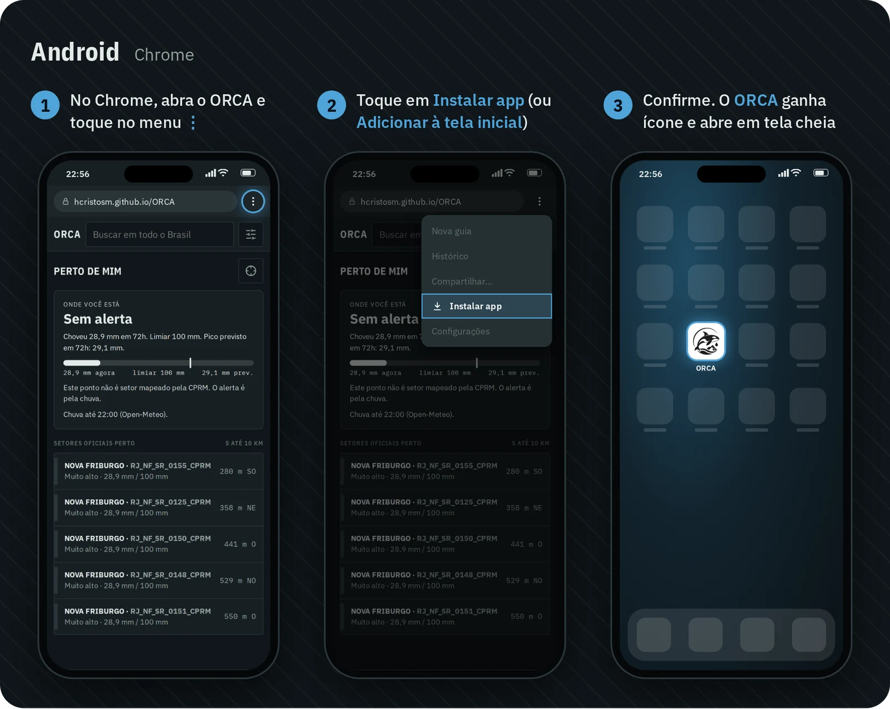

<div align="center">


*Open Risk and Catastrophe Aggregator*

**Setores de risco geológico do Brasil cruzados com chuva recente, num dashboard estático.**

[](CHANGELOG.md)
[](#rodar-localmente)
[](https://hcristosm.github.io/ORCA/)
[](.github/workflows/ci.yml)
[](LICENSE)
[](https://doi.org/10.5281/zenodo.24606726)

*[Read in English](README.en.md)*

</div>

---

## Sobre

O ORCA mostra duas informações públicas no mesmo mapa: o setor de risco
geológico e a chuva recente. Ele lê os setores de risco do
[BELUGA](https://github.com/hcristosm/BELUGA), busca a chuva de cada setor e
marca os que passaram de um limiar de chuva acumulada que você escolhe.

A ideia veio de um problema concreto. Sou geólogo e já mapeei área de risco. As
duas informações são públicas, mas quase nunca aparecem juntas. Eu queria vê-las
lado a lado sem servidor e sem custo: um pipeline em Python gera arquivos
estáticos, e o dashboard no navegador lê esses arquivos. O site roda no GitHub
Pages, e um cron atualiza os dados todo dia.

**Dashboard ao vivo:** [hcristosm.github.io/ORCA/](https://hcristosm.github.io/ORCA/)

<p align="center">
  
  
</p>

> **Atenção:** o ORCA não substitui a Defesa Civil. Ele cruza dado público e
> modelado. Em uma emergência, siga o órgão oficial da sua cidade ou ligue 199.

## Para quem é

- **Defesa civil e gestão municipal.** Abrir o link, escolher a UF e ver num
  mapa só quais setores já mapeados receberam chuva acima do critério que o seu
  órgão usa. Não precisa instalar nada nem criar conta, e o recorte sai em CSV
  ou PDF para o relatório do dia.
- **Pesquisa e ensino.** Comparar limiares de chuva de órgãos diferentes sobre
  o mesmo conjunto de setores, ou usar os dados exportados em aula e em
  trabalho acadêmico.
- **Quem desenvolve.** O código é aberto e os dados são arquivos estáticos. Dá
  para reaproveitar a ingestão, trocar a fonte de chuva ou apontar o dashboard
  para outra base de setores.

## Como ler o dashboard

O dashboard responde uma pergunta: **onde chove muito sobre um setor de risco
conhecido?** Três elementos dão essa resposta.

1. **A hachura** mostra o grau de risco do setor, como o órgão que mapeou
   registrou. Ela não muda com a chuva.
2. **A cor** mostra um setor com chuva acumulada acima do limiar. Só esse estado
   usa cor.
3. **A régua** mostra todos os setores da UF contra o limiar. Cada marca é um
   setor. Você arrasta o limiar e vê quantos setores passam dele.

A janela de acumulação (24h ou 72h) e o limiar são seus. O padrão é 100mm em
72h, um valor ilustrativo. O seletor "Critério" e a aba "Tutorial" trazem os
limiares de órgãos reais, com fonte: Defesa Civil de Santos, Concessionária
Tamoios, PPDC-SP, sirenes do Rio, Belo Horizonte e outros.

O **alerta previsto** usa a previsão de chuva das próximas 72h. Ele indica o
setor que deve passar do limiar se a previsão se confirmar. Não é alerta
oficial.

### Nem todo setor é igual

Os setores vêm de levantamentos diferentes, e isso aparece na tela.

- **Grau de risco.** A maior parte é R1 a R4 (Baixo a Muito alto). As áreas de
  Belo Horizonte, mapeadas em 1996, são **sem grau informado**: têm hachura e
  legenda próprias, entram na contagem e no cruzamento com a chuva.
- **Ponto em vez de polígono.** Recife e Contagem mapearam imóveis e pontos, não
  polígonos. Eles aparecem com marcador próprio, e a conta de "você está dentro
  do setor" vira proximidade de 50 metros.
- **Sobreposição.** Um setor municipal pode cobrir a mesma encosta que um setor
  da CPRM. A ficha de cada setor diz isso, a legenda filtra por essa relação, e
  o setor que repete mais da metade da área de um setor da CPRM fica de fora da
  soma do cabeçalho, com uma linha dizendo quantos foram. Nenhum setor é
  escondido; nenhum é somado duas vezes em silêncio.

## No celular

<p align="center">
  
</p>

No celular, o ORCA abre na aba **Perto de mim**. Ele pede a sua localização e
responde se o lugar onde você está pode entrar em alerta.

- Dá o veredito do ponto: risco iminente, alerta previsto (com a hora), sem
  alerta ou sem dado. Fora de setor mapeado, o alerta vem só da chuva, e a tela
  diz que isso não quer dizer ausência de risco.
- Lista os setores oficiais a até 10 km, com distância, direção e quem mapeou.
- Abre o setor no mapa com um toque. O cartão mostra a chuva, o limiar e os
  botões de compartilhar e de rota.
- Abre sem sinal, com a última consulta e a hora do dado.

A conta roda no aparelho: o celular baixa um índice leve dos setores de todo o
Brasil (`setores_pontos.json`) e consulta a chuva do ponto direto na Open-Meteo.

### Instalar como app

O ORCA se instala pelo navegador, sem loja de aplicativos. Ele ganha ícone e
janela próprios, se atualiza sozinho e se desinstala como qualquer app.

**Android (Chrome):** abra [hcristosm.github.io/ORCA](https://hcristosm.github.io/ORCA/),
toque no menu ⋮ e escolha **Instalar app** (em algumas versões, **Adicionar à
tela inicial**).

<p align="center">
  
</p>

**iPhone (Safari):** abra o mesmo endereço, toque em **Compartilhar** e depois
em **Adicionar à Tela de Início**. No iOS 26, o Compartilhar fica dentro do menu
⋯ da barra do Safari.

<p align="center">
  
</p>

**Computador (Chrome ou Edge):** clique no ícone de instalar, na barra de
endereço.

As barras e os menus nas figuras são esquemáticos. Os nomes das opções mudam um
pouco entre versões.

## O que mais o dashboard faz

- **Cobre as 27 UFs.** A busca de município funciona em todo o Brasil e troca a
  UF sozinha. Município sem setor mapeado também aparece, marcado como tal
  (veja [Limitações](#limitações-conhecidas)).
- **Filtra** o mapa pela legenda e pelos contadores: por grau, por fonte do
  mapeamento, por sobreposição com a CPRM, por "acima do limiar" e por "alerta
  previsto". Pins marcam os setores que pedem atenção.
- **Exporta relatórios** em CSV e PDF, dentro do navegador: a tabela inteira,
  uma linha ou uma área própria. O relatório credita cada fonte com a sua
  licença.
- **Aceita áreas próprias** na aba "Minhas áreas", em GeoJSON, KML ou shapefile
  `.zip` (até 5 áreas, 10MB cada). O arquivo não sai do navegador.
- **Guarda a navegação na URL** (`#/<uf>/<município>?l=<limiar>&j=<janela>`).
  O link compartilhado abre com a mesma régua de quem mandou, e Voltar/Avançar
  funcionam. Sem link, o dashboard reabre onde você parou.
- **Mostra dado ao vivo:** avisos meteorológicos do INMET (lista e polígonos no
  mapa, por UF, região ou Brasil, e por dia), radar de chuva e raios.
- **Diz a idade de cada dado.** O selo de atualização nomeia as fontes daquela
  UF e avisa quando uma delas passa do ciclo esperado.
- **Se mantém atual numa tela de monitoramento:** aba aberta há mais de 30
  minutos e parada há 5 recarrega sozinha.

## Fontes e créditos

Os setores de risco vêm todos do [BELUGA](https://github.com/hcristosm/BELUGA),
projeto irmão que cataloga, coleta e padroniza os mapeamentos de risco do
Brasil. São **21.429 setores em 27 UFs**, de sete fontes:

| Fonte | Órgão | Onde | Setores |
|---|---|---|---:|
| Setorização de Risco Geológico | SGB/CPRM | 27 UFs | 18.890 |
| Setores de risco geológico de Juiz de Fora | SSPDC, Prefeitura de Juiz de Fora | MG | 994 |
| Área de Risco Geológico de Belo Horizonte | PBH (estudo UFMG de 1996) | MG | 665 |
| Áreas de Risco da Regional Sul do Recife | Sedec, Prefeitura do Recife | PE | 364 |
| Risco geológico e hidrológico de Contagem (2024) | Prefeitura de Contagem | MG | 265 |
| Setores de risco de Suzano (2019) | Prefeitura de Suzano | SP | 178 |
| Risco geológico do PMRR de Congonhas | Prefeitura de Congonhas | MG | 73 |

O levantamento de campo é de cada órgão. **Cada setor carrega a licença da sua
fonte**, no dashboard, no relatório e nos créditos. Os dados do Recife são
ODbL, que exige compartilhar o derivado sob a mesma licença.

A chuva vem da [Open-Meteo](https://open-meteo.com/), horária e por coordenada.
É a única fonte de chuva do pipeline: não depende de estação meteorológica.

O navegador de quem olha busca outras fontes ao vivo, fora do pipeline. Se uma
delas cair, só aquela camada falta, e o controle de camadas diz por quê.

| Fonte | Uso no dashboard |
|---|---|
| [IBGE](https://servicodados.ibge.gov.br/) | Malha de municípios e lista de municípios da busca |
| [INMET](https://portal.inmet.gov.br/) | Avisos meteorológicos oficiais |
| [RainViewer](https://www.rainviewer.com/) | Radar de chuva |
| [SSEC RealEarth](https://realearth.ssec.wisc.edu/) | Raios (GOES-19 GLM) |
| [OpenStreetMap](https://www.openstreetmap.org/) | Mapa de fundo |

## Rodar localmente

Requer Python 3.11 ou superior.

```bash
git clone https://github.com/hcristosm/ORCA
cd ORCA
python3 -m venv .venv
.venv/bin/pip install -e ".[dev]"

.venv/bin/python -m src.cli baixar-beluga --ufs SP,RJ,MG
.venv/bin/python -m src.cli atualizar-nacional --ufs SP,RJ,MG
scripts/rodar_dashboard.sh    # http://localhost:8000/dashboard/
```

O dashboard precisa de HTTP: o `fetch()` do navegador não lê `file://`.

Os comandos, os workflows, as guardas de publicação e como reverter estão em
**[docs/funcionamento.md](docs/funcionamento.md)**.

## Limitações conhecidas

- **A cobertura ainda é parcial.** A setorização da CPRM cobre cerca de 1.600
  municípios, e as fontes municipais cobrem seis cidades. Ficam de fora São
  Paulo, Rio de Janeiro e Salvador, e cidades com desastres recentes, como
  Petrópolis, São Sebastião e Guarujá. O ORCA mostra esses municípios na busca
  como sem setor mapeado e dá o alerta só pela chuva. **Falta de setor não é
  falta de risco.**
- **Os levantamentos não são comparáveis entre si.** Datas, metodologias e
  escalas diferentes, de 1996 a 2024. Dois setores com o mesmo grau e fontes
  diferentes não querem dizer o mesmo risco.
- **A chuva é modelada, não medida.** A Open-Meteo entrega reanálise e previsão
  por coordenada, não leitura de pluviômetro. Isso cobre as 27 UFs sem depender
  de estação, mas não é observação direta.
- **Não há fonte de chuva alternativa.** Se a Open-Meteo cair, a UF fica de fora
  do run e o dashboard mostra o dado da véspera.
- **O limiar padrão é ilustrativo.** 100mm/72h é referência comum na literatura,
  não valor oficial calibrado para os setores de risco.
- **O dashboard não atualiza sob demanda.** Ele mostra a exportação do dia. O
  botão "Atualizar agora" de um município busca a chuva de um ponto na hora, mas
  não recalcula a UF.
- **As camadas ao vivo dependem de terceiros.** INMET, radar e raios vêm direto
  do navegador, com timeout de 8s. A camada de raios mostra raio total (nuvem e
  solo), não ponto de impacto.
- **Licenças nem sempre declaradas.** CPRM, Juiz de Fora, Contagem, Suzano e
  Congonhas não declaram licença nos serviços de origem. Isso está registrado,
  não resolvido.

## Sobre como isso foi feito

Sou geólogo, não desenvolvedor de formação. O ORCA foi construído em boa parte
por vibe coding com o Claude Code. Eu trago o problema, o conhecimento do
domínio e as decisões. O Claude escreve a maior parte do código. Eu reviso,
testo e corrijo o rumo quando o resultado não bate com a realidade do dado.

Achei melhor deixar isso claro do que fingir o contrário. Se você encontrar algo
estranho no código, provavelmente é isso. Um issue é bem-vindo.

## Contribuindo

Issues, PRs e sugestões são bem-vindos. Veja o
[guia de contribuição](CONTRIBUTING.md) e o
[Código de Conduta](CODE_OF_CONDUCT.md).

## Como citar

Se o ORCA entrar num trabalho, relatório ou artigo, use o botão **Cite this
repository**, no topo da página do GitHub. Ele lê o
[`CITATION.cff`](CITATION.cff) e entrega a referência em APA e BibTeX. O DOI permanente, que sempre aponta para a versão mais recente, é [10.5281/zenodo.24606726](https://doi.org/10.5281/zenodo.24606726). Cite
também o [BELUGA](https://github.com/hcristosm/BELUGA) e a fonte primária dos
setores: o levantamento de campo é da CPRM/SGB ou do órgão que mapeou.

## Licença

[GNU AGPL v3.0 ou posterior](LICENSE): uso, cópia, modificação e
redistribuição livres, inclusive comerciais, desde que qualquer versão
distribuída **ou oferecida como serviço pela rede** publique o código-fonte
completo sob a mesma licença, mantendo o aviso de copyright de Mateus Hcristos
Leptokarydis. Versões até a v2.1.0 foram publicadas sob BSD 3-Clause.

**Os dados publicados seguem a licença de cada fonte**, informada no
dashboard, nos relatórios e no `manifest.json` do BELUGA. As camadas ao vivo do
mapa vêm de INMET, IBGE, RainViewer, SSEC RealEarth e OpenStreetMap. Consulte os
termos de uso de cada um antes de redistribuir.
