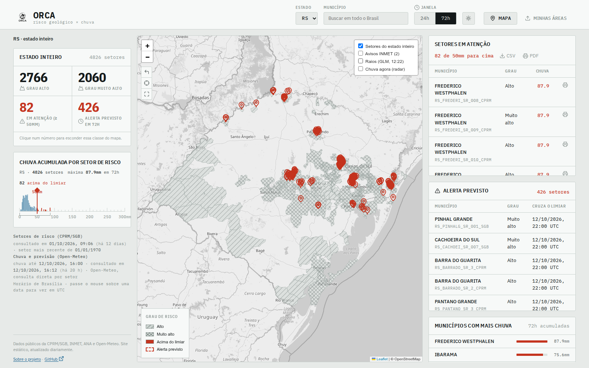
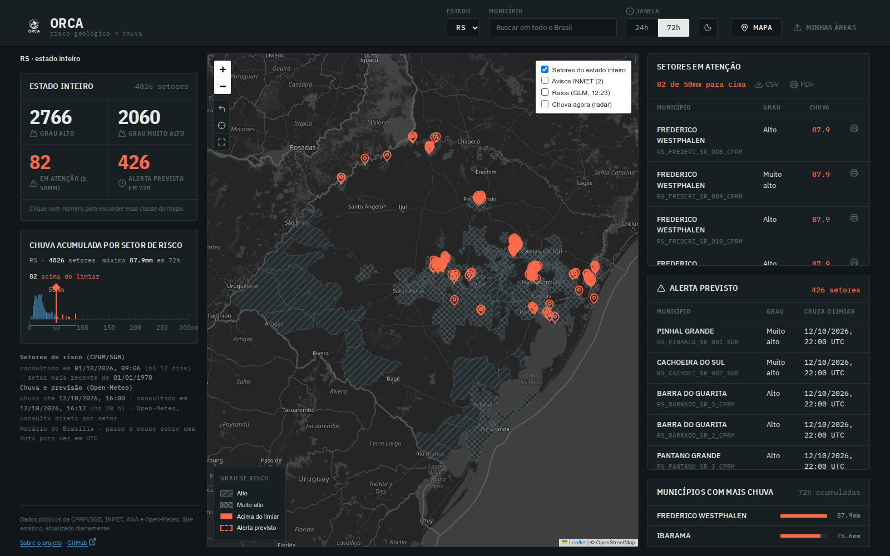
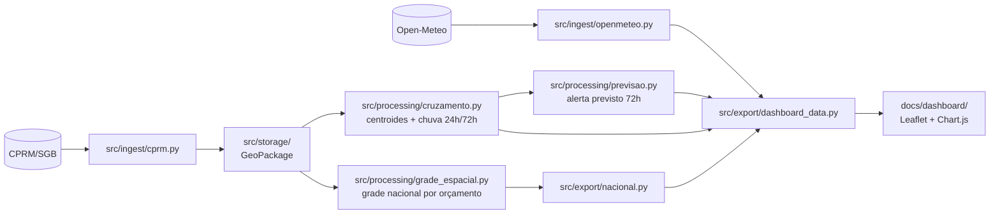
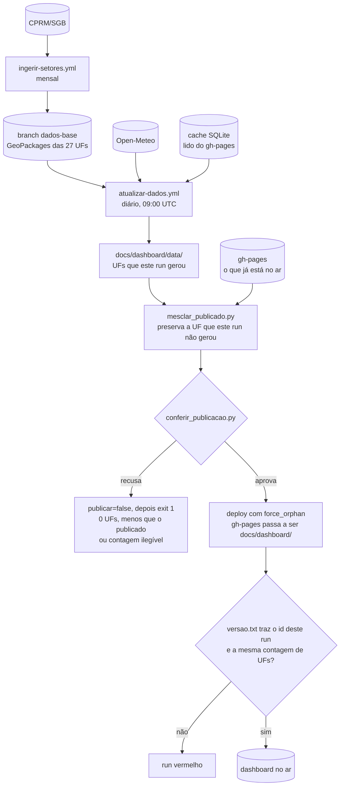

<div align="center">

<picture>
  <source media="(prefers-color-scheme: dark)" srcset="docs/logo/orca-logo-escuro.png">
  <source media="(prefers-color-scheme: light)" srcset="docs/logo/orca-logo-claro.png">
  
</picture>

# ORCA
*Open Risk and Catastrophe Aggregator*

**Setores de risco geológico da CPRM/SGB cruzados com chuva recente, num dashboard estático.**

[](CHANGELOG.md)
[](#instalação)
[](https://hcristosm.github.io/ORCA/)
[](.github/workflows/ci.yml)
[](LICENSE)

*[Read in English](README.en.md)*

</div>

---


## Sobre

O ORCA mostra duas informações públicas no mesmo mapa: o setor de risco
geológico e a chuva recente. Ele baixa a setorização de risco da CPRM/SGB.
Depois busca a chuva de cada setor. Então marca os setores com chuva acumulada
acima de um limiar que você escolhe.

A ideia veio de um problema concreto. Sou geólogo e já mapeei área de risco. Eu
queria ver o dado de risco e o dado de chuva lado a lado, sem backend, sem
servidor e sem custo. As duas informações são públicas, mas quase nunca
aparecem juntas.

O ORCA não tem backend. Um pipeline em Python gera arquivos estáticos. O
dashboard no navegador lê esses arquivos. Por isso o site roda no GitHub Pages
e não custa nada.

**Dashboard ao vivo:** [hcristosm.github.io/ORCA/](https://hcristosm.github.io/ORCA/).
Um cron atualiza os dados todo dia.

**Instale como app:** abra o dashboard no Chrome ou no Edge. Clique no ícone de
instalar, na barra de endereço. No celular, use "Adicionar à tela inicial". O
ORCA ganha ícone e janela próprios. Ele se atualiza sozinho e se desinstala
como qualquer programa.

<p align="center">
  
  
</p>

## O que o projeto faz hoje

**Dados e cobertura**

- Cobre as **27 UFs**. O dashboard tem um seletor de estado.
- Baixa os setores de risco da CPRM/SGB de forma incremental. Guarda cada UF em
  um GeoPackage.
- Busca a chuva horária na **Open-Meteo**, no centro de cada setor. Não depende
  de estação meteorológica.
- Calcula a chuva acumulada de 24h e de 72h.
- Calcula uma trajetória de alerta previsto para as próximas 72h.
- Exporta tudo como GeoJSON e JSON estáticos.

**Mapa e leitura**

- Serve um dashboard em HTML, CSS e JavaScript puro. O mapa usa Leaflet e o
  gráfico usa Chart.js. Há tema claro e tema escuro.
- Mostra o grau de risco como hachura, no estilo de carta geológica. A cor fica
  reservada a uma coisa só: o setor acima do limiar.
- Plota todos os setores da UF contra o limiar, em uma régua. Você arrasta o
  limiar e a régua responde.
- Marca com pins os setores acima do limiar e os setores em alerta previsto.
  Clique em um pin para descer ao município.
- Filtra o mapa pela legenda e pelos contadores, por grau, por "acima do
  limiar" e por "alerta previsto".
- Usa três colunas com rolagem própria: contexto, mapa e painel. O mapa fica
  sempre à vista. Abaixo de 1081px de largura, as colunas empilham.

**Ferramentas do visitante**

- Exporta relatórios em CSV e em PDF, dentro do navegador. Você exporta a tabela
  inteira, uma linha só ou uma área própria.
- Aceita uma área própria na aba "Minhas áreas", em GeoJSON, KML ou shapefile
  em `.zip`. O limite é de 5 áreas e de 10MB por arquivo. O cálculo acontece no
  navegador. O arquivo não vai para servidor nenhum.
- Explica a régua na aba "Tutorial". A aba também reúne limiares de referência
  com fonte: Defesa Civil de Santos, Concessionária Tamoios, PPDC-SP, sirenes do
  Rio, Petrópolis, Belo Horizonte e Tatizana et al. Ela cita também a literatura
  que justifica o acumulado de 72h. Cada critério que cabe na régua tem um botão
  "Usar Xmm/Yh". O botão aplica a janela e o limiar, e volta ao mapa.
- Busca município em todo o Brasil, não só na UF selecionada. Se você escolher
  uma cidade de outro estado, o dashboard troca a UF sozinho.
- Guarda a navegação na URL (`#/<uf>/<município>`). Você usa Voltar e Avançar do
  navegador, compartilha o link e clica na trilha.

**Monitoramento ao vivo**

- Mostra um selo de atualização por fonte, em horário de Brasília: setores da
  CPRM/SGB e chuva. O selo informa a idade do dado. Ele avisa quando uma fonte
  passa do ciclo esperado.
- Lista os avisos meteorológicos oficiais do INMET no painel, por ordem de
  severidade. A lista tem dois recortes: abrangência (esta UF, a macrorregião do
  IBGE da UF atual ou o Brasil) e dia (hoje, amanhã e os próximos dias com
  aviso). Assim a lista responde "vai cair tempestade no Sudeste no domingo?".
  Clique em um aviso para enquadrar o polígono no mapa. A camada segue o mesmo
  recorte da lista.
- Liga e desliga três camadas ao vivo no mapa: avisos do INMET (ligada por
  padrão, com polígono na cor da severidade, riscos e instruções), radar de
  chuva (RainViewer) e raios (GOES-19 GLM, via SSEC RealEarth, como indicador de
  tempestade).

**Operação**

- Roda dois workflows separados: os setores uma vez por mês e a chuva uma vez
  por dia.
- Tem 161 testes com HTTP mockado. O CI roda a suíte a cada push.

## Como ler o dashboard

O dashboard responde uma pergunta: **onde chove muito sobre um setor de risco
conhecido?** Três elementos dão essa resposta.

1. **A hachura** mostra o grau de risco do setor, de acordo com a CPRM/SGB. Ela
   não muda com a chuva.
2. **A cor** mostra um setor com chuva acumulada acima do limiar. Só esse estado
   usa cor.
3. **A régua** mostra todos os setores da UF contra o limiar. Cada marca é um
   setor. Você arrasta o limiar e vê quantos setores passam dele.

A janela de acumulação e o limiar são seus. O padrão é 100mm em 72h. Esse valor
é ilustrativo, e a aba "Tutorial" mostra os limiares de órgãos reais.

O alerta previsto usa a previsão de chuva das próximas 72h. Ele indica o setor
que deve passar do limiar, se a previsão se confirmar. Ele não é um alerta
oficial.

> **Atenção:** o ORCA não substitui a Defesa Civil. Ele cruza dado público e
> modelado. Em uma emergência, siga o órgão oficial da sua cidade.

## Fontes de dados

O pipeline fala com duas fontes:

| Fonte | O que fornece | Endpoint |
|---|---|---|
| [CPRM/SGB](https://www.sgb.gov.br/) | Polígonos de setorização de risco (grau, tipologia, moradias e pessoas afetadas) | `geoportal.sgb.gov.br/.../risco/FeatureServer/0` (ArcGIS REST) |
| [Open-Meteo](https://open-meteo.com/) | Chuva horária por coordenada, sem estação. Única fonte de chuva | `api.open-meteo.com/v1/forecast` |

A CPRM virou SGB. Os domínios antigos (`geoportal.cprm.gov.br` e companhia)
ainda respondem em parte. A camada de risco hoje mora em
`geoportal.sgb.gov.br`.

O navegador de quem olha busca mais cinco fontes ao vivo. Elas não passam pelo
pipeline:

| Fonte | Camada no mapa |
|---|---|
| [IBGE](https://servicodados.ibge.gov.br/) | Malha de municípios (choropleth) |
| [INMET](https://portal.inmet.gov.br/) | Avisos meteorológicos oficiais |
| [RainViewer](https://www.rainviewer.com/) | Radar de chuva |
| [SSEC RealEarth](https://realearth.ssec.wisc.edu/) | Raios (GOES-19 GLM) |
| [OpenStreetMap](https://www.openstreetmap.org/) | Mapa de fundo |

Se uma dessas cinco cair, a camada some ou o mapa degrada para quem está
olhando. O pipeline nem percebe. Em "Minhas áreas", a chuva também vem da
Open-Meteo direto do navegador.

## Arquitetura



Cada módulo tem uma responsabilidade:

| Módulo | O que faz |
|---|---|
| `src/cli.py` | Reúne os comandos da linha de comando (Typer) |
| `src/config.py` | Guarda **toda** convenção de caminho e as constantes. Use `caminho_setores()` em vez de montar um caminho à mão |
| `src/ingest/cprm.py` | Baixa os setores de risco por UF, com paginação e marcador d'água |
| `src/ingest/openmeteo.py` | Busca a chuva horária por coordenada, em lotes de 50 pontos |
| `src/ingest/rate_limiter.py` | Controla o ritmo das requisições. É compartilhado |
| `src/storage/` | Camada fina sobre GeoPackage, para os setores. Não há banco de dados |
| `src/storage_cache_openmeteo.py` | Guarda em SQLite a chuva já baixada, para não repetir hora já buscada. Ele grava só a hora que já passou, para a previsão não entrar no acumulado como chuva observada |
| `src/processing/cruzamento.py` | Dá os centroides (por setor e por município) e acumula a chuva na janela |
| `src/processing/grade_espacial.py` | Monta a grade adaptativa nacional, por busca binária |
| `src/processing/previsao.py` | Calcula a trajetória de alerta de 72h |
| `src/export/dashboard_data.py` | Exporta uma UF |
| `src/export/nacional.py` | Orquestra as 27 UFs com uma grade compartilhada |

O dashboard já foi um app Streamlit. Ele virou site estático por três motivos:
o controle do layout e da estética, a publicação como página e a independência
de um processo Python em execução.

## Estrutura do repositório

```
src/                      pipeline em Python
tests/                    161 testes, com HTTP mockado
scripts/                  guarda de publicação, mescla e atalho do dashboard
docs/dashboard/           front-end estático (publicado em gh-pages)
docs/dashboard/data/      saídas do pipeline (ignoradas pelo git)
data/                     GeoPackages locais (ignorados pelo git)
.github/workflows/        CI, ingestão mensal, atualização diária, release
.github/actions/          preparar-python e baixar-branch
```

O front-end não tem build. São quatro arquivos: `index.html`, `comum.js` (que
carrega primeiro e expõe `window.ORCA`), `areas-customizadas.js` e
`relatorio.js`.

## Instalação

O ORCA requer Python 3.11 ou superior.

```bash
git clone https://github.com/hcristosm/ORCA
cd ORCA
python3 -m venv .venv
source .venv/bin/activate
pip install -e ".[dev]"
```

## Uso

### Baixar os setores de risco

Este comando fala com a CPRM/SGB. Rode-o uma vez por mês.

```bash
python -m src.cli ingerir-setores --diretorio data        # as 27 UFs
python -m src.cli ingest-cprm --uf SP                     # uma UF só
# -> data/risco_sp.gpkg
```

A ingestão é incremental. Um marcador d'água por UF registra o que já veio. Na
próxima vez, o ORCA pede só o que mudou.

### Exportar os dados do dashboard

```bash
python -m src.cli exportar-dashboard --uf SP
# -> docs/dashboard/data/setores_sp.geojson, series_sp.json, meta_sp.json, previsao_sp.json
```

Este comando precisa dos setores já ingeridos. A chuva vem da Open-Meteo na
hora.

Para todas as UFs de uma vez:

```bash
python -m src.cli atualizar-nacional --ufs SP,RJ,MG       # sem --ufs = as 27
```

O `atualizar-nacional` calcula uma grade espacial nacional única antes de
exportar. Assim os setores próximos compartilham o mesmo ponto de consulta,
mesmo em UFs vizinhas. Isso mantém o total de pontos dentro de
`--orcamento-alvo` (o padrão é 6.000; o teto gratuito da Open-Meteo é
10.000/dia). O comando não ingere nada. Ele espera os GeoPackages já em `data/`.

### Abrir o dashboard

```bash
scripts/rodar_dashboard.sh    # atalho para python -m http.server 8000 --directory docs
```

Depois abra `http://localhost:8000/dashboard/`.

Você precisa servir o dashboard por HTTP. O `fetch()` do navegador não lê
`file://`.

## Referência da linha de comando

| Comando | Para que serve | Opções principais |
|---|---|---|
| `ingerir-setores` | Baixa os setores de várias UFs | `--ufs`, `--diretorio`, `--backoff-factor` |
| `ingest-cprm` | Baixa os setores de uma UF | `--uf`, `--output`, `--timeout`, `--max-retries` |
| `exportar-dashboard` | Exporta uma UF para o dashboard | `--uf`, `--diretorio`, `--saida` |
| `atualizar-nacional` | Exporta várias UFs com grade compartilhada | `--ufs`, `--orcamento-alvo`, `--diretorio`, `--saida` |

Os dois comandos que os workflows chamam são o `ingerir-setores` (mensal) e o
`atualizar-nacional` (diário).

## Arquivos que o dashboard consome

O pipeline grava em `docs/dashboard/data/`. Todos os nomes ficam em minúsculas.

| Arquivo | Conteúdo |
|---|---|
| `setores_<uf>.geojson` | Polígonos dos setores, com grau, chuva acumulada e alerta |
| `series_<uf>.json` | Série horária de chuva por município |
| `previsao_<uf>.json` | Trajetória de alerta para as próximas 72h |
| `meta_<uf>.json` | Fonte, data de referência, totais e idade do dado |
| `ufs_disponiveis.json` | Lista das UFs publicadas |
| `versao.txt` | Id do run que publicou. Serve ao teste de fumaça |

O `ufs_disponiveis.json` guia o seletor de estado do front-end. Ele é também a
métrica da guarda anti-regressão.

## Variáveis de ambiente

| Variável | Efeito | Padrão |
|---|---|---|
| `ORCA_PISO_COBERTURA` | Piso de cobertura que a publicação aceita | `0.6` |
| `ORCA_LOG_LEVEL` | Nível de log do pipeline | `INFO` |

## Como roda em produção



O setor de risco muda em escala de meses. A chuva muda em escala de horas. Por
isso há dois workflows:

- **Mensal** ([`ingerir-setores.yml`](.github/workflows/ingerir-setores.yml)):
  baixa os setores das 27 UFs e publica os GeoPackages na branch `dados-base`.
  É o único ponto do projeto que fala com a SGB. Os timeouts são generosos
  (120s, 5 tentativas) e não há fallback de cache. Se a SGB cair, o run falha
  alto, em vez de fechar verde com dado vazio. A ingestão também desconfia do
  HTTP 200: ela repete o erro do ArcGIS que chega com status 200 e recusa a
  carga vazia, que gravaria um GeoPackage de 0 setores.
- **Diário** ([`atualizar-dados.yml`](.github/workflows/atualizar-dados.yml),
  `0 9 * * *`): lê os setores da `dados-base`, roda o `atualizar-nacional` e
  publica no `gh-pages`. Ele não toca em nenhuma fonte `.gov.br`.

Se a SGB cair, o dashboard continua no ar com os setores da `dados-base`.

Uma UF ruim não derruba as outras. Um erro inesperado em uma UF — GeoPackage
corrompido ou schema novo da SGB — para só aquela UF. As demais seguem, e o run
falha no fim, para a falha ficar visível.

A publicação é não-destrutiva. Antes de subir, o job busca o `gh-pages` atual.
Ele preserva os dados das UFs que este run não regenerou
([`scripts/mesclar_publicado.py`](scripts/mesclar_publicado.py)). A UF que
falhou não some do dashboard: ela envelhece.

Três guardas protegem essa mescla, e toda recusa falha o run:

- A guarda recusa se o run não exportou UF nenhuma.
- A guarda recusa se a cobertura nova fica abaixo do piso. O padrão é 60% e a
  variável `ORCA_PISO_COBERTURA` ajusta o valor. Em um run manual com `--ufs`,
  o piso mede contra as UFs pedidas (`--pedidas`), não contra as 27. Esse 0,6 saiu dos 12 runs
  limpos entre 10 e 23/08/2026, com cobertura entre 70% e 100%. O piso fica
  abaixo do pior caso normal e ainda barra os casos degenerados reais, de 4% e
  de 7%.
- A guarda recusa conjunto vazio, contagem publicada ilegível ou regressão no
  total de UFs em relação ao que já está no ar.

A lógica mora em [`scripts/conferir_publicacao.py`](scripts/conferir_publicacao.py).
Os dois workflows compartilham esse script. A guarda sempre grava
`publicar=false` no `$GITHUB_OUTPUT` **antes** de sair com 1, nessa ordem. O
output pula a publicação. O exit 1 deixa a recusa visível: uma guarda silenciosa
em um cron diário poderia bloquear a publicação por semanas sem ninguém notar.

Depois do deploy, um teste de fumaça espera a URL pública servir o deploy
daquele run. O marcador é o `versao.txt` com o id do run, lido por fora do cache
do CDN. O teste confere também o número de UFs no ar. Contar UFs sozinho não
prova nada, porque o deploy de ontem também tem 27. É o marcador que prova que o
site é deste run. Se o build do Pages falhar, ou se o site servir outra coisa, o
run fica vermelho.

Essas guardas existem por um motivo real. Em 22 e 23/08/2026, dois runs
publicaram 1 e 2 UFs de 27 e fecharam como `success`, com a ingestão da CPRM em
timeout. **Nunca julgue um run pelo status. Meça o resultado nos logs.**

## Branches

| Branch | Conteúdo |
|---|---|
| `main` | Código |
| `dados-base` | GeoPackages dos setores da CPRM (ingestão mensal) |
| `gh-pages` | Dashboard publicado e cache da Open-Meteo |

O deploy usa `force_orphan`. Por isso o `gh-pages` vira exatamente o conteúdo de
`docs/dashboard/`. Uma publicação com `data/` vazio apagaria as 27 UFs e o cache
junto. É contra isso que a guarda existe.

## Testes e gates

```bash
.venv/bin/python -m pytest -q
.venv/bin/python -m ruff check .
.venv/bin/python -m mypy src
.venv/bin/python -m bandit -q -c pyproject.toml -r src
```

O CI roda esses quatro comandos a cada push. Rode-os antes de commitar.

Os 161 testes cobrem:

- a ingestão da CPRM: ArcGIS REST, paginação, incremental por marcador d'água e
  retry;
- a Open-Meteo: lotes, retry e o cache SQLite;
- o processamento: grade espacial nacional, acumulação de chuva e previsão;
- a publicação: exportação, guarda anti-regressão e mescla não-destrutiva com o
  `gh-pages`.

Toda chamada de rede é mockada, então a suíte roda sem internet.

O dashboard em si (HTML e JavaScript) não tem teste automatizado. A validação
dele é manual.

## Limitações conhecidas

- **A chuva é modelada, não medida.** A Open-Meteo entrega reanálise e previsão
  por coordenada, não leitura de pluviômetro. Isso permite cobrir as 27 UFs sem
  depender da densidade de estações. Não é observação direta.
- **Não há fonte de chuva alternativa.** A Open-Meteo é a única. Se ela cair, a
  UF fica de fora do run e o dashboard envelhece, em vez de sumir: a mescla com
  o `gh-pages` preserva o dado da véspera.
- **O limiar de atenção é ilustrativo.** O padrão de 100mm/72h é referência
  comum na literatura de deslizamento. Não é valor oficial calibrado para os
  setores da CPRM/SGB. O dashboard avisa isso, deixa o valor ajustável e mostra
  na aba "Tutorial" os limiares que órgãos reais usam.
- **A publicação no `gh-pages` ainda não é reversível.** O deploy usa
  `force_orphan: true`, então a branch tem um commit só. Isso existe por causa
  do blob de cache da Open-Meteo (~45MB), que muda todo dia. Para abandonar o
  `force_orphan`, é preciso primeiro tirar o cache de lá. Até então, a proteção
  é preventiva, não reversível.
- **A Open-Meteo limita por volume, não só por frequência.** O teste com
  requisição real mostrou isso: um POST com as ~900 coordenadas de SP funciona
  sozinho, mas o mesmo volume repetido gera `429` de forma consistente. O
  `src/ingest/openmeteo.py` divide em lotes de 50 pontos, usa janela de
  histórico curta e espera 60s em `429`.
- **As camadas ao vivo dependem de terceiros.** O navegador busca os avisos do
  INMET, o radar e os raios na hora, com timeout de 8s. Se a fonte cair ou
  parar de responder, a camada não aparece e o bloco de avisos diz que a fonte
  está indisponível. O timeout é o que torna esses dois casos iguais: um host
  que pendura não rejeita o `fetch`, e sem ele a camada sumia em silêncio. Esse estado é
  distinto de "nenhum aviso ativo", porque um `.gov.br` fora do ar responde 200
  com o HTML do portal. O resto do painel não depende dessas fontes. A camada de
  raios é omitida também quando o quadro mais recente tem mais de 30 minutos.
  Ela mostra raio total (nuvem e solo), não ponto de impacto.
- **Não há autenticação nem multiusuário.** O ORCA é ferramenta local e de
  portfólio.
- **O dashboard não atualiza sob demanda.** Ele mostra a última exportação, que
  roda uma vez por dia. Para ver dado mais novo na hora, rode o
  `exportar-dashboard` localmente.

## Decisões e investigações

As decisões maiores foram testadas com requisição real, não por suposição.

- **Streamlit para site estático:** resolveu a estética, o layout e a
  distribuição.
- **Open-Meteo como única fonte de chuva:** ela responde chuva por coordenada,
  sem depender de estação. O INMET e a ANA foram implementados e descartados. O
  INMET só publica o ZIP anual, com dias de defasagem. A rede da ANA é
  majoritariamente fluviométrica. Manter as duas trilhas custava ~1.900 linhas
  que nenhum workflow executava. Os avisos oficiais do INMET voltaram só como
  lista e camada do mapa, lidas pelo navegador. Eles não entram no cálculo.
- **Cobertura nacional:** ingestão incremental da CPRM, mais uma grade espacial
  calibrada por busca binária. A alternativa era um limiar de densidade
  escolhido a dedo.
- **Grafo de código descartado:** a avaliação de 12/09/2026 mediu um
  `graph.json` de 825 KB contra 121 KB de todo o `src/`. O mapa custava mais que
  o território. Um README e um CLAUDE.md explícitos resolvem melhor.

## Roadmap

- Tirar o cache da Open-Meteo do `gh-pages`, para abandonar o `force_orphan` e
  recuperar o histórico da branch publicada.
- Fallback municipal, com camadas de prefeituras em ArcGIS REST. A investigação
  de 14/08/2026 para Itaquaquecetuba/SP não confirmou endpoint público. O item
  espera um município piloto com dado aberto.
- Orquestração melhor das requisições à Open-Meteo: paginação, backoff mais
  completo e talvez uma fila para espaçar o envio.

## Sobre como isso foi feito

Sou geólogo, não desenvolvedor de formação. O ORCA foi construído em boa parte
por vibe coding com o Claude Code. Eu trago o problema, o conhecimento do
domínio e as decisões. O Claude escreve a maior parte do código. Eu reviso,
testo e corrijo o rumo quando o resultado não bate com a realidade do dado.

Achei melhor deixar isso claro do que fingir o contrário. Se você encontrar algo
estranho no código, provavelmente é isso. Um issue é bem-vindo.


## Contribuindo

Issues, PRs e sugestões são bem-vindos. Veja o
[guia de contribuição](CONTRIBUTING.md) e o
[Código de Conduta](CODE_OF_CONDUCT.md).

## Licença

[GNU AGPL v3.0 ou posterior](LICENSE): uso, cópia, modificação e
redistribuição livres, inclusive comerciais, desde que qualquer versão
distribuída **ou oferecida como serviço pela rede** publique o código-fonte
completo sob a mesma licença, mantendo o aviso de copyright de Mateus Hcristos
Leptokarydis. Versões até a v2.1.0 foram publicadas sob BSD 3-Clause.

Os dados públicos pertencem aos seus órgãos:
[CPRM/SGB](https://www.sgb.gov.br/) e [Open-Meteo](https://open-meteo.com/).
As camadas ao vivo do mapa vêm de INMET, IBGE, RainViewer, SSEC RealEarth e
OpenStreetMap. Consulte os termos de uso de cada um antes de redistribuir.
